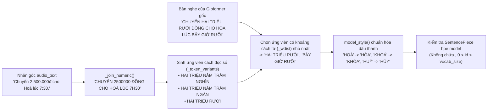

# Báo cáo Đối chiếu & Đề xuất Cải tiến Pipeline ASR: Hiện tại vs. `Datyth/ZaloAI-Challenge-lifemate`

Tài liệu này phân tích toàn diện tầng **ASR (Automatic Speech Recognition)** — từ lựa chọn mô hình, giải mã suy luận, chuẩn hóa văn bản, huấn luyện thích nghi miền (domain adaptation) trên tập TRAIN cho tới cách kết nối đầu ra ASR vào dữ liệu SFT của LLM — giữa **Pipeline hiện tại** ([`code/`](code/)) và **Repo của Datyth** ([`Datyth/ZaloAI-Challenge-lifemate`](https://github.com/Datyth/ZaloAI-Challenge-lifemate), đạt **61.26** điểm Public Test).

---

## 1. Bảng Tổng hợp Đối chiếu Nhanh

| Hạng mục ASR | `Datyth/ZaloAI-Challenge-lifemate` | Pipeline Hiện tại ([`code/`](code/)) | Đánh giá & Chênh lệch |
| :--- | :--- | :--- | :--- |
| **Backbone gốc** | `g-group-ai-lab/gipformer1.5-68M-rnnt` (Zipformer-RNNT 68M) | `g-group-ai-lab/gipformer1.5-68M-rnnt` (Zipformer-RNNT 68M) | **Giống nhau** (đều là backbone tốt nhất cho tiếng Việt miền hội thoại) |
| **Trọng số sử dụng lúc Inference** | **Đã Fine-tune toàn mạng (ASR v3 / Final)** trên toàn bộ **5,036 audio TRAIN** (gồm cả câu hiện tại và lịch sử user) | **Pretrained Zero-shot gốc** (chưa fine-tune trên dữ liệu LifeMate) | **Khác biệt lớn nhất:** Bản gốc có WER **15.2%**, bản fine-tuned v3 giảm còn **7.74%** |
| **Độ chính xác số học (Precision)** | **FP32 ONNX** (`encoder.onnx`, `decoder.onnx`, `joiner.onnx`, `--enable-int8-quantization 0`) | **INT8 ONNX mặc định** (`encoder.int8.onnx`, `decoder.int8.onnx`, `joiner.int8.onnx`) | FP32 giữ độ chính xác âm học tốt hơn mà vẫn chạy cực nhanh (~70ms/file trên CPU) |
| **Thuật toán Giải mã (Decoding)** | **`modified_beam_search`** (`max_active_paths=4`) | **`greedy_search`** | `modified_beam_search` ghép BPE subword tiếng Việt và xử lý từ đồng âm tốt hơn `greedy_search` |
| **Tăng tốc Giải mã trên CPU** | Offline: `ProcessPoolExecutor` (10 workers $\times$ 2 threads); Docker: chạy trực tiếp trên CPU (~70ms/file) song song với vLLM trên GPU | Tách tiến trình con `--stage asr` (`CUDA_VISIBLE_DEVICES=""`), giải mã **tuần tự từng file một** (`transcribe()`) dù đã có hàm `transcribe_batch()` | `prepare_transcripts` chưa gọi `transcribe_batch` (`decode_streams` theo lô) |
| **Chuẩn hóa Hậu ASR** | `normalize_asr`: viết thường toàn bộ, gộp khoảng trắng (`" ".join(text.lower().split())`), **không** thêm dấu chấm câu | `normalize_transcript`: NFC + viết thường + **viết hoa chữ cái đầu tiên** + **thêm dấu `.` cuối câu** | Cả hai đều đồng nhất giữa SFT và Inference; viết thường giúp tránh lệch với `audio_text` |
| **Xử lý Số đọc (ITN)** | **Gỡ bỏ hoàn toàn ITN lúc inference** (đo thấy chỉ +0.6 Val trong vùng nhiễu); để Qwen3.5-4B tự hiểu số đọc tiếng Việt từ dữ liệu SFT | Giữ bộ phát hiện bảo thủ `itn_candidates` ([`code/lifemate/itn.py`](code/lifemate/itn.py)) làm bằng chứng phụ trợ + tool `local_text.normalize` | Đã tắt các bước gọi helper dư thừa ở P0; giữ `itn_candidates` bảo thủ không gây hại |
| **Chiến lược Nhãn khi Fine-tune ASR** | `target_v3` ([`asr_targets.py`](https://github.com/Datyth/ZaloAI-Challenge-lifemate/blob/main/scripts/train/asr_targets.py)): IN HOA, bỏ dấu câu, đổi dấu thanh sang kiểu mới (`HOÀ` $\rightarrow$ `HÒA`), **sinh mọi cách đọc số tiếng Việt của nhãn chuẩn rồi chọn cách đọc gần bản nghe của Gipformer nhất** | Chưa có pipeline fine-tune ASR | Tránh lỗi `<unk>` BPE (từng làm hỏng model xuống 99% WER) và cứu được **112/368 câu có số (30%)** |
| **Augmentation khi Fine-tune ASR** | Speed perturbation (`0.9, 1.0, 1.1`), cộng nhiễu Gaussian (`SNR 15–30 dB`), `SpecAugment` (2 mask tần số, $\le 4$ mask thời gian) | Chưa có | Giúp giảm hiện tượng đứng dev loss sau epoch 1 |
| **Nguồn ASR cho LLM SFT** | Dùng bản ASR lỗi nhiều hơn (Gipformer gốc hoặc Cross-fit) để dạy LLM chịu nhiễu, kết hợp dùng **ASR Final (đã fine-tune)** lúc Inference | Dùng chung 1 model Pretrained INT8 cho cả `prepare_sft.py` và Inference | Nếu fine-tune ASR trên TRAIN rồi lấy chính nó chạy lại trên TRAIN sẽ bị học thuộc (WER 4.6%), làm LLM yếu đi khi gặp test thật (WER 8.7%) |

## 3. Phân tích Chi tiết 5 Cải tiến Kỹ thuật ASR của Datyth

### 3.1. Giải mã bằng `modified_beam_search` + Trọng số FP32 (`encoder.onnx`, `decoder.onnx`, `joiner.onnx`)
* **Hiện tại ([`code/lifemate/asr.py`](code/lifemate/asr.py#L38-L48)):**
  * [`LocalASR`](code/lifemate/asr.py#L38) mặc định nạp các file lượng tử hóa `.int8.onnx` và cấu hình `decoding_method="greedy_search"`:
    ```python
    self.model = sherpa_onnx.OfflineRecognizer.from_transducer(
        **{name: str(path) for name, path in files.items()},
        num_threads=num_threads, sample_rate=16000, feature_dim=80,
        decoding_method="greedy_search", provider="cpu",
    )
    ```
* **Trong repo Datyth (`src/lifemate/asr.py`, `scripts/infer/asr_cache.py`):**
  * Luôn sử dụng mô hình **FP32** (`encoder.onnx`, `decoder.onnx`, `joiner.onnx`) và `decoding_method="modified_beam_search"` (mặc định `max_active_paths=4`).
  * Vì Gipformer chỉ nặng 68M tham số (~270MB ở định dạng FP32) và chạy hoàn toàn trên CPU trong ~0.07s/file, việc lượng tử hóa xuống INT8 và dùng `greedy_search` làm giảm chất lượng ghép âm tiết tiếng Việt mà hầu như không tiết kiệm thời gian tổng thể (vì thời gian chạy toàn pipeline do LLM quyết định).

### 3.2. Khắc phục 3 Bẫy Dữ liệu khi Fine-tune Gipformer trên Tập TRAIN (`asr_targets.py` & `train_gipformer.py`)
Khi fine-tune Gipformer (`model.pt` gốc trong repo HuggingFace `g-group-ai-lab/gipformer1.5-68M-rnnt` có sẵn đầy đủ trọng số PyTorch + đầu phụ trợ CTC), nếu đưa trực tiếp `audio_text` của tập TRAIN vào làm nhãn đích, mô hình sẽ **sụp đổ hoàn toàn (WER 99%)** vì 3 nguyên nhân mà Datyth đã xử lý triệt để:



1. **Bẫy từ vựng BPE (`<unk>`):**
   * Bộ `bpe.model` (SentencePiece) của Gipformer **chỉ chứa chữ IN HOA, không dấu câu, không chữ số 0–9**. Nếu để chữ thường hoặc chữ số, 48.8% token biến thành `<unk>` và phá hỏng hoàn toàn bộ dự đoán RNN-T.
2. **Bẫy vị trí đặt dấu thanh tiếng Việt (`model_style`):**
   * Nhãn `audio_text` của BTC dùng quy tắc đặt dấu kiểu cũ (`HOÀ`, `KHOÁ`, `HUỶ`, `THUỶ`), trong khi BPE của Gipformer được huấn luyện theo quy tắc kiểu mới (`HÒA`, `KHÓA`, `HỦY`, `THỦY`). Hàm `model_style` chuyển đổi đồng nhất trước khi mã hóa BPE:
     ```python
     def model_style(text: str) -> str:
         text = re.sub(r"O([ÀÁẢÃẠ])(?=\s|$)", lambda m: {"À": "ÒA", "Á": "ÓA", "Ả": "ỎA", "Ã": "ÕA", "Ạ": "ỌA"}[m.group(1)], text)
         text = re.sub(r"O([ÈÉẺẼẸ])(?=\s|$)", lambda m: {"È": "ÒE", "É": "ÓE", "Ẻ": "ỎE", "Ẽ": "ÕE", "Ẹ": "ỌE"}[m.group(1)], text)
         text = re.sub(r"(?<!Q)U([ỲÝỶỸỴ])(?=\s|$)", lambda m: {"Ỳ": "ÙY", "Ý": "ÚY", "Ỷ": "ỦY", "Ỹ": "ŨY", "Ỵ": "ỤY"}[m.group(1)], text)
         return text
     ```
3. **Bẫy cách đọc số trong âm thanh (`target_v3` trong `scripts/train/asr_targets.py`):**
   * Văn bản `audio_text` viết `"45 phút"`, `"218k"`, `"7:30"`, `"15/11"`, nhưng người nói trong file `.wav` có thể đọc là *"bốn mươi lăm phút"* hoặc *"bốn lăm phút"*, *"hai trăm mười tám nghìn"* hoặc *"hai trăm mười tám ngàn"*.
   * Ở bản `v2`, Datyth chép thẳng đoạn từ chỉ số trong transcript của Gipformer gốc sang nhãn: cách này làm **mất 112/368 câu có số (30%)** và chép nhầm ít nhất **7 nhãn số bị Gipformer gốc nghe sai** (ví dụ *"30%"* bị dạy thành *"NĂM MƯƠI PHẦN TRĂM"*, *"131 triệu"* thành *"MỘT TRĂM NĂM MƯƠI MỐT TRIỆU"*).
   * Ở bản **`v3` (`target_v3`)**: Với mỗi token chứa chữ số trong `audio_text`, hàm `_token_variants` sinh **tất cả các cách đọc tiếng Việt hợp lệ của đúng con số đó** (bao gồm biến thể *nghìn/ngàn*, *linh/lẻ*, *rưỡi*, giờ/phút, đọc từng chữ số cho số điện thoại), sau đó dùng khoảng cách chỉnh sửa mức từ (`_wdist`) so với đoạn tương ứng mà Gipformer gốc nghe được để chọn cách phát âm khớp thực tế âm thanh nhất. Nhờ đó giữ lại được **368/368 câu có số** với nhãn đúng 100% giá trị.

### 3.3. Công thức Huấn luyện Gipformer (`train_gipformer.py` & `export_gipformer.py`)
* **Dữ liệu:** Gom toàn bộ cặp `(audio, audio_text)` từ cả lượt hiện tại (`item["audio"]`) và các lượt lịch sử của người dùng (`turn["audio"]` với `role == "user"` trong `item["history"]`), tổng cộng **5,036 bản ghi âm duy nhất** trên toàn tập TRAIN (`prepare_gipformer_sft.py --final`).
* **Kiến trúc & Loss:** Tải nghiêm ngặt (`strict=True`) từ `model.pt` qua Icefall (`egs/librispeech/ASR/zipformer/train.py`) trong môi trường `.venv-asr` độc lập (`torch==2.8.0+cu128`, `k2`, `kaldifeat`, `lhotse`). Mở khóa toàn bộ tham số (`--train-all`), tối ưu hàm loss kết hợp RNN-T + CTC chuẩn của Zipformer:
  $$\mathcal{L} = \frac{0.5 \cdot \mathcal{L}_{\text{simple}} + 1.0 \cdot \mathcal{L}_{\text{pruned}} + 0.2 \cdot \mathcal{L}_{\text{ctc}}}{\max(1, N_{\text{tokens}})}$$
* **Siêu tham số & Augmentation:** `AdamW(lr=2e-5, weight_decay=0.01)`, `accum=4`, `clip_grad_norm=1.0`, `3 epochs`, bật `--augment`:
  * **Speed perturbation:** lấy mẫu tốc độ $\in \{0.9, 1.0, 1.1\}$ qua phép resample Kaldi-style.
  * **Additive noise:** xác suất $0.3$ cộng nhiễu trắng Gaussian với $\text{SNR} \sim \mathcal{U}(15, 30)\text{ dB}$.
  * **SpecAugment:** xác suất $0.8$ che 2 dải tần số (rộng $0\text{–}15$ trên 80 mel bins) và tối đa 4 dải thời gian.
* **Thời gian train & Xuất ONNX:** Chỉ mất **~1 giờ trên 1 GPU 24GB**, xuất ra `encoder.onnx`, `decoder.onnx`, `joiner.onnx` (FP32) bằng `export-onnx.py` và kiểm tra tự động không phát sinh `<unk>` hay `<blk>`.

### 3.4. Chống Học thuộc Nhiễu ASR khi Chuẩn bị Dữ liệu SFT cho LLM
Một phát hiện rất quan trọng trong báo cáo `docs/noise_asr_analysis_2026-11-08.md` của Datyth:
* Khi dùng mô hình **ASR đã fine-tune trên tập TRAIN** để nhận dạng lại chính các file audio của tập TRAIN, WER trên tập TRAIN giảm tụt xuống **4.6%** (52% số câu khớp tuyệt đối 100%), trong khi WER thực tế khi chạy trên tập Validation/Test chưa từng thấy là **8.7%**.
* Nếu dùng bản transcript quá sạch (WER 4.6%) này làm nhánh `asr` trong `prepare_sft.py`, LLM sẽ **ít được rèn luyện với lỗi nhận dạng thực tế**.
* Ngược lại, dùng bản transcript từ **Gipformer Pretrained gốc** (WER 14.5%) hoặc **5-fold Cross-fit ASR** (chia TRAIN làm 5 phần, train trên 4 phần và nhận dạng phần thứ 5) cho bước `prepare_sft.py`, đồng thời dùng **Gipformer Final (đã fine-tune)** khi chạy Inference (`main.py`), giúp LLM chịu nhiễu mạnh hơn mà lúc thi thật lại được nhận đầu vào ASR sạch nhất (**71.87 Val / 61.26 Public**).

### 3.5. Các Hướng Cải tiến ASR Đã Thử và Bị Bác bỏ (Không nên làm lại)

> [!CAUTION]
> **3 hướng dưới đây đã được Datyth cài đặt, đo đạc kỹ trên 200 mẫu Val / 634 mẫu Public và xác nhận KHÔNG hiệu quả hoặc làm giảm điểm:**
> 1. **Gợi ý từ vựng theo ngữ cảnh (`sherpa-onnx` Hotword Biasing từ `user_profile` & `history`):**
>    * Dù giúp tăng số thực thể trong history được nhận dạng đúng từ `149/221` lên `171/221`, nhưng khi khớp một phần âm tiết trên câu hiện tại lại làm biến dạng từ khóa thông thường (ví dụ *"giặt"* $\rightarrow$ *"giao dịch"*, *"lịch đó"* $\rightarrow$ *"lịch thanh"*), làm điểm Val trên các mẫu có thay đổi transcript giảm **-0.17 điểm**.
> 2. **Sinh thêm dữ liệu âm thanh bằng TTS (`VieNeu-TTS` nhân bản giọng — ASR v4):**
>    * Bổ sung 1,202 câu TTS chứa tên nước ngoài và số mới vào quá trình fine-tune Gipformer làm điểm end-to-end trên Val tụt từ **71.87 xuống 68.64 (-3.23 điểm)** do lệch phân bố âm học thực tế.
> 3. **Dùng bộ quy tắc ITN viết đè chữ số trực tiếp lên chuỗi transcript ASR:**
>    * Thay thế chuỗi số đọc trong transcript chỉ dao động **+0.6 điểm Val** (nằm trong biên độ nhiễu) và có nguy cơ phá hỏng các cụm từ lân cận. Cách hiện tại của pipeline mình (giữ nguyên `request_transcript` gốc và chỉ đính kèm `itn_candidates` độc lập khi chắc chắn) an toàn hơn.

---

## 4. Lộ trình Đề xuất Cải tiến cho Pipeline Hiện tại (`code/`)

Dựa trên phân tích trên, dưới đây là các đề xuất cải tiến cụ thể cho [`code/`](code/) sắp xếp theo tỷ lệ **Hiệu quả / Chi phí thực hiện**:

### Ưu tiên P0 #1 — Chuyển sang FP32 ONNX + `modified_beam_search` + Giải mã Batch trong `prepare_transcripts` (Sửa ngay trong code, 0 giờ GPU)

* **Vấn đề trong code hiện tại:**
  1. [`code/scripts/download_models.py`](code/scripts/download_models.py#L21) và [`code/main.py`](code/main.py#L62) đang để mặc định `--asr-precision int8`, và [`code/models/asr/`](code/models/asr/) hiện mới chỉ tải 3 file `.int8.onnx`.
  2. [`code/lifemate/asr.py`](code/lifemate/asr.py#L47) đang cố định `decoding_method="greedy_search"`.
  3. [`code/lifemate/transcripts.py`](code/lifemate/transcripts.py#L145-L170) đang gọi `asr.transcribe()` tuần tự từng file trong vòng lặp `for`, bỏ phí hàm [`LocalASR.transcribe_batch`](code/lifemate/asr.py#L68) (`decode_streams` theo lô) đã được viết sẵn ngay trong [`code/lifemate/asr.py`](code/lifemate/asr.py#L68-L104).
* **Cách sửa đề xuất:**
  1. Trong [`code/scripts/download_models.py`](code/scripts/download_models.py#L21-L37): tải thêm `encoder.onnx`, `decoder.onnx`, `joiner.onnx` (FP32) cùng `bpe.model` và `model.pt` từ `g-group-ai-lab/gipformer1.5-68M-rnnt`.
  2. Trong [`code/lifemate/asr.py`](code/lifemate/asr.py#L38-L48) và [`code/lifemate/transcripts.py`](code/lifemate/transcripts.py#L65-L77):
     * Hỗ trợ cấu hình `decoding_method="modified_beam_search"` và `max_active_paths=4` (hoặc tự động ưu tiên file `.onnx` FP32 khi có sẵn trên đĩa, fallback về `.int8.onnx` cho các unit test dùng fixture).
  3. Trong [`code/lifemate/transcripts.py`](code/lifemate/transcripts.py#L150-L170):
     * Thu thập danh sách tất cả các file audio cần nhận dạng (cả `item["audio"]` và `history` chưa có text) rồi gọi `asr.transcribe_batch(audio_paths, batch_size=16)` trước khi ghi cache, giúp giảm thời gian chạy `--stage asr` trên CPU từ vài phút xuống vài chục giây.

---

### Ưu tiên P0 #2 — Sử dụng / Huấn luyện Checkpoint Gipformer Thích nghi Miền (`ASR v3 / Final`) (+2.0 đến +3.2 điểm Public)

* **Vấn đề hiện tại:**
  * Đang dùng Gipformer Pretrained zero-shot (WER ~15.2%, mất ~28% tham số nói nguyên văn và nghe sai hàng loạt từ khóa *"dời"*, *"đặt"*, *"nhắc"*, *"nhắn"*, *"SJC"*).
* **Hai phương án triển khai (tùy quỹ thời gian và môi trường):**
  * **Phương án 2A (Nhanh nhất — Kiểm chứng ngay trong 10 phút):**
    * Tải trực tiếp bộ trọng số ONNX `asr-gipformer` đã được fine-tune trên 5,036 audio TRAIN (với `target_v3` + SpecAugment) từ repo release công khai `hugebenevolence/lifemate-final` (được khai báo trong `configs/release.sh` của Datyth) vào `code/models/asr/` để đo ngay mức cải thiện WER và điểm số end-to-end.
  * **Phương án 2B (Tự huấn luyện lại đầy đủ từ `g-group-ai-lab/gipformer1.5-68M-rnnt` — ~1 giờ GPU):**
    * Chuyển 4 script độc lập từ repo Datyth sang `code/scripts/asr_finetune/`:
      1. `prepare_gipformer_sft.py`: trích xuất toàn bộ 5,036 cặp `(audio, audio_text)` từ `train.jsonl` (cả câu hiện tại và các lượt `user` trong `history`).
      2. `asr_targets.py`: áp dụng `target_v3` (sinh biến thể cách đọc số tiếng Việt của nhãn chuẩn và khớp khoảng cách từ `_wdist` với bản nghe của Gipformer gốc) + `model_style` (chuẩn hóa dấu thanh `HOÀ` $\rightarrow$ `HÒA`).
      3. `train_gipformer.py`: tạo môi trường `.venv-asr` (`k2` + `kaldifeat` + `icefall`), fine-tune toàn bộ 68M tham số trong **3 epochs** (`lr=2e-5`, `accum=4`, bật `--augment` với speed perturbation `0.9/1.0/1.1`, Gaussian noise và SpecAugment).
      4. `export_gipformer.py`: xuất checkpoint sang `encoder.onnx`, `decoder.onnx`, `joiner.onnx` (FP32).

---

### Ưu tiên P1 #3 — Tách Biệt Nguồn ASR Lúc Train LLM SFT và Lúc Inference + Lọc Mẫu ASR Mất Tham số

* **Vấn đề:**
  * Nếu sau khi có mô hình ASR Fine-tuned (P0 #2), ta dùng chính mô hình đó chạy trên tập TRAIN để sinh dữ liệu SFT cho LLM (`prepare_sft.py`), LLM sẽ chỉ thấy transcript có WER 4.6% (quá sạch do ASR đã học thuộc lòng audio TRAIN) và kém bền vững khi gặp audio mới ở Public/Private Test (WER ~8%–9%).
  * Ngoài ra, khoảng **4% mẫu ASR** trên tập TRAIN làm mất hoàn toàn giá trị tham số bắt buộc (không phải fuzzy text) hoặc làm mất từ phủ định (*"không"*), tạo ra nhãn mâu thuẫn dạy LLM thói quen "tự bịa tên" khi không nghe rõ.
* **Cách sửa đề xuất trong [`code/prepare_sft.py`](code/prepare_sft.py):**
  1. **Giữ nguồn nhiễu thực tế cho `prepare_sft.py`:**
     * Khi chạy `prepare_sft.py` để tạo nhánh transcript `asr` và tạo các quỹ đạo phục hồi `asr_name` ([`code/lifemate/recovery.py`](code/lifemate/recovery.py)), sử dụng transcript từ **Gipformer Pretrained gốc** (hoặc bản **5-fold cross-fit**), còn khi chạy Inference ([`code/main.py`](code/main.py)) thì nạp **Gipformer Fine-tuned (FP32 + `modified_beam_search`)**.
  2. **Thêm bộ lọc mẫu ASR mâu thuẫn (`--filter-damaged-asr`):**
     * Trong `prepare_sft.py`, với bản sao `transcript_source == "asr"`, kiểm tra nếu một tham số kiểu chuỗi `exact-match` (hoặc số/ngày giờ bắt buộc) xuất hiện nguyên văn trong `audio_text` và trong `gold_tool_calls`, nhưng lại bị biến mất hoàn toàn trong bản `asr` (và không có bước `read` tool nào để tra cứu lại), thì bỏ qua bản sao `asr` của mẫu đó (chỉ giữ bản `audio_text` và bản `recovery` nếu có) để không dạy LLM đoán mò tham số.

---

## 5. Bảng Tóm tắt Thứ tự Triển khai Đề xuất

| Mức ưu tiên | Hạng mục | File tác động trong [`code/`](code/) | Thời gian thực hiện | Kỳ vọng cải thiện |
| :---: | :--- | :--- | :---: | :--- |
| **P0 #1** | Bật `modified_beam_search` (`beam=4`), hỗ trợ nạp FP32 `.onnx` và dùng `transcribe_batch` trong `prepare_transcripts` | [`code/lifemate/asr.py`](code/lifemate/asr.py), [`code/lifemate/transcripts.py`](code/lifemate/transcripts.py), [`code/scripts/download_models.py`](code/scripts/download_models.py), [`code/main.py`](code/main.py) | ~30 phút code, 0h GPU | Giảm lỗi ghép âm tiết & tăng tốc giai đoạn ASR trên CPU gấp 3–5 lần |
| **P0 #2** | Nạp hoặc Fine-tune **Gipformer v3 / Final** (3 epochs, `target_v3`, Speed/Noise/SpecAugment trên 5,036 audio TRAIN) | `code/models/asr/`, `code/scripts/asr_finetune/` | 10 phút (dùng bản có sẵn) hoặc ~1h GPU (tự train) | Giảm WER từ **15.2% $\rightarrow$ 7.74%**, **+2.0 đến +3.2 điểm** Public Test |
| **P1 #3** | Dùng ASR gốc/cross-fit khi tạo dữ liệu SFT LLM + lọc ~4% bản sao `asr` bị mất tham số exact-match không thể khôi phục | [`code/prepare_sft.py`](code/prepare_sft.py) | ~30 phút code | Ngăn LLM học thói quen tự bịa tên/số khi ASR nghe thiếu |
