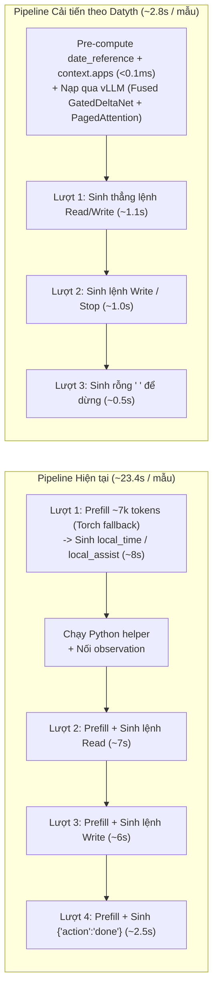

# Đề xuất Cải tiến Pipeline LLM (Dựa trên Đối chiếu với `Datyth/ZaloAI-Challenge-lifemate`)

Tài liệu này tổng hợp các điểm nghẽn thực tế của pipeline hiện tại (`code/`) dựa trên báo cáo đối chiếu [LLM_PIPELINE_COMPARISON_REPORT.md](LLM_PIPELINE_COMPARISON_REPORT.md) cùng số liệu log thực nghiệm (`code/logs/finetune_pipeline_20261104_183040.log`), từ đó đưa ra **lộ trình sửa đổi cụ thể** theo 3 mục tiêu:
1. **Cải tiến độ chính xác của LLM Agent** (Tăng tỷ lệ khớp `state_hash` và F1 của `tool_calls`).
2. **Tối ưu thời gian Inference** (Giảm từ trung bình **23.4s/mẫu** hiện tại xuống **~3s/mẫu**, loại bỏ hoàn toàn các mẫu vượt ngưỡng 30s).
3. **Tối ưu thời gian Training** (Giảm từ **~15–22 giờ/lần train** xuống **~3.5–5 giờ/lần train** trên 1 GPU 24GB).

---

## Tổng quan Chẩn đoán Thực trạng (Từ Log Thực nghiệm)

Số liệu trích xuất trực tiếp từ `code/logs/finetune_pipeline_20261104_183040.log` của pipeline hiện tại so với `Datyth/ZaloAI-Challenge-lifemate` trên cùng phần cứng 1 GPU 24GB:

| Chỉ số | Pipeline Hiện tại (`code/`) | Repo của Datyth (`p1` Release) | Chênh lệch / Vấn đề của Pipeline hiện tại |
| :--- | :--- | :--- | :--- |
| **Thời gian Inference (634 câu Public)** | **14,834.8s (~4.12 giờ)** | **~1,825s (~30 phút, 1 luồng)** | Chậm hơn **8.1 lần** |
| **Trung bình thời gian / mẫu** | **23.40s / mẫu** | **2.88s / mẫu** | Nhiều mẫu mất **35s–55s** (vi phạm luật 30s/mẫu của BTC) |
| **Số mẫu SFT / Số bước Train** | 5,264 bước SFT $\rightarrow$ **1,974 steps** (3 epochs, thêm tới ~15k bước nếu bật `rename-variants`) | 3,274 quỹ đạo $\rightarrow$ **~800 steps** (2 epochs) | Số step nhiều gấp **2.5–5 lần** do tách lẻ từng bước quyết định |
| **Tốc độ mỗi step Train** | **~27.5s / step** (~15–22 giờ) | **~20–25s / step** (~4.3–5.6 giờ) | Tính logits `lm_head` thừa trên toàn bộ prompt (98% token không tính loss) |
| **Kernel GatedDeltaNet lúc Inference** | Bị fallback về PyTorch thuần (`Falling back to torch implementation`) | Chạy fused kernel qua **vLLM (`v0.32.0`)** | Thiếu `flash-linear-attention` / `causal-conv1d` hoặc chưa dùng vLLM |

---

## Phần 1: Cải tiến Chất lượng & Điểm số LLM (LLM Accuracy)

### 1.1. Giảm trọng số Loss cho các tham số văn bản tự do (`--fuzzy-weight 0.3`)
* **Vấn đề hiện tại ([`code/lifemate/sft.py`](code/lifemate/sft.py), [`code/train_lora.py`](code/train_lora.py)):**
  * Hàm loss hiện đánh trọng số `1.0` ngang nhau cho mọi token của `assistant`.
  * Theo thống kê token-level loss của Datyth, các tham số có `"x-match": "fuzzy"` trong catalog (như `email.body`, `chat_ott.content`, `tasks.title`, `calendar.title`, `reminders.content`) chỉ chiếm **4–6% số token được train**, nhưng lại chiếm tới **42–66% tổng giá trị loss** trên tập mẫu chưa thấy.
  * Trong khi đó, hàm chấm điểm của BTC **bỏ qua các trường fuzzy khi băm `state_hash`** và chỉ yêu cầu độ trùng lặp từ vựng $\text{F1} \ge 0.5$. Việc để trọng số `1.0` khiến LoRA dồn phần lớn dung lượng để học thuộc lòng văn phong tin nhắn thay vì học chọn đúng tên tool và tham số exact-match.
* **Cách sửa theo Datyth:**
  * Khi mã hóa chuỗi đích của `assistant`, xác định các khoảng ký tự nằm trong thẻ `<parameter=key>...</parameter>` mà `key` có thuộc tính `"x-match": "fuzzy"` trong schema của tool đó.
  * Gán `loss_weight = 0.3` cho các token thuộc vùng fuzzy và `1.0` cho các token còn lại (tên hàm, cấu trúc XML, ID, ngày giờ, số tiền, enum), đồng thời giữ nguyên mẫu số chuẩn hóa theo tổng số token được train.

### 1.2. Bổ sung Dữ liệu Phục hồi sau Tìm kiếm Rỗng (`Recovery Trajectories`)
* **Vấn đề hiện tại ([`code/prepare_sft.py`](code/prepare_sft.py)):**
  * Nhãn gold của tập TRAIN hầu như không có trường hợp gọi lệnh tìm kiếm (`contacts.search`, `maps.search_place`, `news.search`...) trả về rỗng.
  * Nhưng trên Public Test (do nhiễu ASR và 45% câu rơi vào ứng dụng mới), có tới **75/634 mẫu (11.8%)** gặp kết quả rỗng ở lần tìm kiếm đầu tiên. Vì chưa từng thấy tình huống này lúc SFT, model thường lặp lại đúng câu truy vấn đó hoặc dừng sớm (điểm trung bình nhóm này tụt từ 71 xuống 20).
* **Cách sửa theo Datyth (`inject_recovery.py`):**
  * Viết bước hậu xử lý SFT tạo thêm ~90–180 quỹ đạo phục hồi chạy trên `ToolEnv` thật theo 3 mẫu lỗi phổ biến:
    1. **Danh xưng (`honorific`):** Người dùng nói *"nhắn cho anh Dũng"*, chèn bước 1 gọi `contacts.search(query="anh Dũng")` (chạy trên `ToolEnv` trả về `[]`), bước 2 gọi `contacts.search(query="Dũng")` (trả về đúng liên hệ).
    2. **Tên bị ASR nghe méo (`asr_name`):** Bước 1 tìm theo cụm từ ASR nghe sai (trả về `[]`), bước 2 tìm theo từ cuối của tên hoặc truyền `query=""` / `{}` để liệt kê toàn bộ danh bạ.
    3. **Từ khóa quá dài (`long_query`):** Bước 1 tìm kèm các từ lân cận trong câu nói (trả về `[]`), bước 2 rút gọn về từ khóa chính.
  * **Quan trọng:** Gắn cờ `"train": False` (mask `labels = -100`) cho bước gọi tìm kiếm sai đầu tiên. Model sẽ không học hành vi tìm sai, mà **chỉ học phản xạ sửa sai sau khi nhận kết quả rỗng**.

### 1.3. Đưa Tên & Mô tả Tiếng Việt của App (`context.apps`) vào Prompt
* **Vấn đề hiện tại ([`code/lifemate/prompt_session.py`](code/lifemate/prompt_session.py), [`code/lifemate/catalog.py`](code/lifemate/catalog.py)):**
  * 65% mẫu trên Public Test có cài đặt ứng dụng chưa từng xuất hiện trong tập TRAIN.
  * Người dùng Việt thường gọi ứng dụng bằng tên tiếng Việt hoặc chức năng (*"kiểm tra bên ví"*, *"app đi chợ"*, *"app nhắc việc"*). Catalog gốc của BTC có trường `name` tiếng Việt và `description` ở cấp độ từng app (`catalog["apps"]`), nhưng `load_catalog` hiện tại của mình chỉ trích xuất danh sách `tools` mà **bỏ quên tên tiếng Việt và mô tả cấp độ app**.
* **Cách sửa theo Datyth (Orchestration `E1P`):**
  * Giữ lại metadata `_app: {"id": app["id"], "name": app["name"], "description": app["description"]}` khi đọc catalog.
  * Bơm thêm từ điển `"apps": {app_id: f"{app_name}: {app_description}"}` vào `user_context` trong prompt của cả SFT và Inference.

### 1.4. Loại bỏ Đổi tên Ẩn danh `app_17.tool_42` (`AppAugmenter`) và Chuyển sang 100% Gold + 100% ASR
* **Vấn đề hiện tại ([`code/lifemate/data_generalization.py`](code/lifemate/data_generalization.py), [`code/lifemate/sft.py`](code/lifemate/sft.py)):**
  * Hiện tại `finetune.py` bật mặc định `--rename-variants 2` (đổi tên app/tool thành định danh vô nghĩa như `app_17.tool_42`) và chỉ dùng tỷ lệ trộn `--asr-transcript-ratio 0.5` (mỗi sample chỉ được học 1 bản: hoặc `audio_text` hoặc `asr`).
  * Thực nghiệm Leave-Apps-Out (LAO) của Datyth chứng minh việc đổi tên app khi train làm **giảm 1.1 điểm** trên các app lạ, vì nó phá vỡ sự liên kết ngữ nghĩa giữa tên hàm tiếng Anh có nghĩa với mô tả tool và câu nói của người dùng, đồng thời làm phình kích thước dữ liệu gấp 3 lần.
  * Việc chia 50:50 khiến một nửa số tác vụ trong tập TRAIN chưa bao giờ được học cách xử lý lỗi nhận dạng ASR, và nửa còn lại chưa bao giờ được nhìn thấy văn bản sạch.
* **Cách sửa theo Datyth:**
  * **Tắt `--rename-variants`** (`--rename-variants 0 --distractor-probability 0.0`).
  * **Nhân đôi toàn bộ tập TRAIN thành 2 bản (`100% Gold` + `100% ASR`):** Mỗi sample đều được sinh cả 1 quỹ đạo với `audio_text` chuẩn và 1 quỹ đạo với transcript ASR thực tế trên cùng chuỗi `tool_calls` đích.
  * Giảm số epoch từ `3` xuống **`2` epochs** và hạ learning rate từ `2e-4` xuống **`1e-4`** (log của Datyth cho thấy sang epoch 3 loss tụt xuống `0.003` do học vẹt và làm giảm 4 điểm trên tập validation).

### 1.5. Siết chặt Bộ tiền kiểm (`Pre-Execution Guards`) trước `env.call`
* **Vấn đề hiện tại ([`code/lifemate/tool_execution.py`](code/lifemate/tool_execution.py), [`code/lifemate/execution_policy.py`](code/lifemate/execution_policy.py)):**
  * Mọi lời gọi vượt qua `env.validate(name, args)` đều được đưa thẳng vào `env.call(name, args)`. Nhưng trong `zaic_tools`, một lệnh truyền ID bịa đặt (ví dụ đoán mã cổ phiếu `THDA`, `VHM` hoặc đoán ID sự kiện) vẫn hợp lệ về mặt JSON Schema (`env.validate` trả về `ok: True`), nên nó **vẫn bị thực thi vào `ToolEnv`** (trả về `ok: True, done: False`) và **nằm vĩnh viễn trong danh sách `env.get_tool_calls()`**, làm tụt điểm F1!
  * Ngoài ra, khi một công cụ đọc trả về rỗng, `LoopMonitor` hiện tại chỉ chặn nếu gọi lại **cùng tham số y hệt**, không chặn việc model thử 8 từ khóa/ngày tháng liên tiếp làm cạn sạch ngân sách `max_calls = 8`.
* **Cách sửa theo Datyth ([`src/lifemate/agent.py`](https://github.com/Datyth/ZaloAI-Challenge-lifemate/blob/main/src/lifemate/agent.py#L201-L237)):**
  1. **Chặn cứng tham số `x-ref` chưa được quan sát:** Thu thập mọi giá trị của các trường `id` / `*_id` từ `history` và kết quả các lệnh `read` thành công trước đó theo từng ứng dụng (`observed_ids[app]`). Nếu schema của tham số có khai báo `"x-ref"` mà giá trị truyền vào không nằm trong `observed_ids[app]`, **chặn ngay trước `env.call`** và trả lỗi yêu cầu gọi read tool trước.
  2. **Thêm `retry_cap = 2` cho mỗi Read Tool:** Đếm số lần một read tool trả về kết quả rỗng (`ok: False`, `done: False`, hoặc tất cả các list trong dict kết quả đều rỗng `[]`). Nếu chạm ngưỡng 2 lần rỗng, khóa luôn read tool đó trong sample hiện tại và nhắc model gọi `sys.ask_missing_info` hoặc chuyển bước tiếp theo.
  3. **Xóa tham số lọc rỗng của Read Tool:** Trước khi validate một tool có `kind == "read"`, tự động loại bỏ các tham số không nằm trong `required` nếu giá trị của chúng là `None`, `""`, `[]`, `{}`.
  4. **Xóa `location` mặc định cho `weather.get_current` / `weather.get_forecast`:** Nếu model truyền `location` trùng với `user_profile.city` mà từ khóa thành phố đó không xuất hiện trong `transcript`, tự động `args.pop("location")` để khớp quy ước nhãn gold của BTC.

---

## Phần 2: Tối ưu Thời gian Inference (Từ 23.4s/mẫu xuống <3s/mẫu)

Hiện tại 634 câu Public Test mất **4 giờ 07 phút** (trung bình **23.4s/mẫu**, nhiều mẫu **35s–55s**). Nguyên nhân đến từ 3 nút cổ chai lớn và cách khắc phục triệt để như sau:



### 2.1. Thay thế các lượt gọi `local_time.*` / `local_assist.solve` bằng Tiền tính toán trong Prompt (`Zero-Turn Context`)
* **Nguyên nhân gây chậm:**
  * Trong thiết kế hiện tại, để giải quyết một câu có ngày giờ tương đối (*"sáng mai"*, *"thứ ba tuần sau"*), LLM phải tốn **1 lượt sinh hoàn chỉnh** để phát lệnh `<tool_call><function=local_assist.solve>...</tool_call>`, đợi Python chạy, sau đó nối kết quả vào prompt và chạy **thêm 1 lượt prefill + decode nữa** mới gọi được tool của ứng dụng.
  * Mỗi lượt sinh trên HF Transformers hiện tốn **5–8 giây**. Việc đẻ thêm các lượt gọi `local_*` làm tăng số bước LLM trung bình từ ~2.2 lượt lên ~3.8 lượt/mẫu.
* **Giải pháp:**
  * Tính sẵn bảng lịch 15 ngày `date_reference` (từ hôm qua đến +13 ngày sau kèm tên thứ tiếng Việt, khoảng `this_week` và `next_week` từ `local_time.calendar_reference`) và **gắn thẳng vào `user_context["date_reference"]`** ngay trước lượt gọi LLM đầu tiên (tốn `< 0.1ms` CPU).
  * Với `itn_candidates` (đã được tính sẵn trong `fixed_prompt_payload`) và `date_reference` có sẵn trong prompt, **loại bỏ các bước gọi helper đơn giản trong SFT** để LLM gọi trực tiếp tool của ứng dụng ngay từ lượt 1. Chỉ giữ lại helper khi thực sự cần tính toán phức tạp sau lệnh đọc.

### 2.2. Cắt giảm ~30% Độ dài Prompt bằng cách bỏ trùng lặp `tool_index` + Schemas của `local_*`
* **Nguyên nhân gây chậm:**
  * Trong [`code/lifemate/catalog.py`](code/lifemate/catalog.py) và [`prompt_session.py`](code/lifemate/prompt_session.py#L25-L42), mỗi tool đang bị đưa vào prompt **2 lần**: một lần nằm trong `available_tools.tool_index` (gồm `name`, `kind`, `description`) nằm trong JSON của user message, và một lần nữa nằm trong thẻ `<tools>` của native chat template Qwen3.5!
  * Cộng thêm 9 schema rất dài của các công cụ nội bộ (`local_assist.solve`, `local_batch.run`, `local_time.*`, `local_entity.*`, `local_checks.*`, `local_schema.inspect`) và `NATIVE_SYSTEM_PROMPT` dài gấp 3 lần prompt của Datyth, làm mỗi mẫu bị đội thêm **1,500 – 2,500 prompt tokens**.
* **Giải pháp:**
  * Khi đã dùng native function calling của Qwen3.5 (`tools=...` trong `apply_chat_template`), **xóa hoàn toàn `available_tools` (`tool_index` và `tool_schemas`) ra khỏi JSON của `user` message** (vì toàn bộ `tools` đã được chat template tự động render ở đầu system prompt).
  * Thu gọn các schema `local_*` không cần thiết sau khi đã chuyển `date_reference` vào `user_context`.

### 2.3. Chuyển Runtime Suy luận sang **vLLM** (hoặc cài đặt `flash-linear-attention` + `causal-conv1d` và gỡ Vision Tower)
* **Nguyên nhân gây chậm nghiêm trọng nhất (xem dòng 16326 của log):**
  * Log thực tế báo:
    ```text
    The fast path is not available because one of the required library is not installed. Falling back to torch implementation. To install follow https://github.com/fla-org/flash-linear-attention#installation and https://github.com/Dao-AILab/causal-conv1d
    ```
  * Khi chạy `Qwen3.5-4B` bằng `AutoModelForImageTextToText` trên Transformers mà thiếu `flash-linear-attention` và `causal-conv1d`, toàn bộ 24 lớp `Qwen3_5GatedDeltaNet` phải chạy bằng vòng lặp PyTorch tuần tự cực chậm trên GPU!
  * Hơn nữa, `AutoModelForImageTextToText` nạp cả phần Vision Tower vào VRAM và chạy qua vỏ bọc đa phương thức.
* **Giải pháp (2 cấp độ):**
  * **Cấp độ 1 (Tốt nhất — Giống Datyth):** Chuyển sang phục vụ mô hình bằng **vLLM (`vllm/vllm-openai:v0.32.0`)** với cờ `--language-model-only --enable-auto-tool-choice --tool-call-parser qwen3_coder --reasoning-parser qwen3` và gọi qua HTTP client nhẹ. Cách này tận dụng toàn bộ fused kernels của vLLM, giảm thời gian trung bình xuống **~2.88s/mẫu** và cho phép chạy 2–4 luồng song song.
  * **Cấp độ 2 (Nếu giữ kiến trúc In-process Transformers hiện tại):**
    1. Bắt buộc cài đặt `flash-linear-attention` (`fla`) và `causal-conv1d` vào môi trường chạy để kích hoạt fast-path CUDA/Triton kernel cho `Qwen3_5GatedDeltaNet`.
    2. Đổi kết thúc lượt từ việc sinh 5 token `{"action":"done"}` sang sinh 1 token khoảng trắng `" "` + `<|im_end|>` để tiết kiệm bước decode cuối.

---

## Phần 3: Tối ưu Thời gian Training (Từ ~15–22 giờ xuống ~3.5–5 giờ)

Hiện tại một lần chạy `finetune.py` mất từ **15 đến 22 giờ** (`1,974 steps × 27.5s/step`). Áp dụng 3 thay đổi dưới đây từ repo của Datyth sẽ rút ngắn thời gian train xuống còn **~3.5 – 5 giờ**:

```mermaid
flowchart TB
    subgraph OldTrain["Training Hiện tại (~1,974 steps, ~15-22 giờ)"]
        O1["1 Quỹ đạo 4 bước -> Tách thành 4 mẫu SFT riêng"] --> O2["Prefill lại Prompt ~6,000 tokens 4 lần"]
        O2 --> O3["Chạy lm_head (vocab 248,320) trên cả 6,000 tokens\n(dù 98.4% token có label = -100)"]
        O3 --> O4["Nhân 3 dữ liệu qua AppAugmenter x 3 Epochs"]
    end

    subgraph NewTrain["Training Cải tiến theo Datyth (~600-800 steps, ~3.5-5 giờ)"]
        N1["1 Quỹ đạo 4 bước -> Gộp vào 1 mẫu SFT duy nhất\n(Gán label != -100 cho cả 4 lượt Assistant)"] --> N2["Prefill Prompt ~6,000 tokens đúng 1 lần"]
        N2 --> N3["Dùng logits_to_keep / UNSLOTH_RETURN_HIDDEN_STATES=1\nChỉ chạy lm_head trên ~90 tokens của Assistant"]
        N3 --> N4["Bỏ AppAugmenter, dùng 100% Gold + 100% ASR x 2 Epochs"]
    end
```



### 3.1. Gộp SFT theo Toàn Quỹ đạo (`Full-Trajectory SFT`) thay vì tách từng Bước (`Step-wise SFT`)
* **Vấn đề trong [`code/lifemate/sft.py`](code/lifemate/sft.py#L158-L270):**
  * Một mẫu có $K$ bước gọi tool đang được tách thành $K+1$ dòng trong `train.jsonl`.
  * Vì phần đầu của prompt (System Prompt + Tool Schemas + History) dài khoảng **5,000 – 10,000 tokens** còn câu trả lời của assistant chỉ dài **~20–30 tokens**, việc tách thành $K+1$ mẫu khiến GPU phải tính forward và backward qua 5,000–10,000 tokens đó **$K+1$ lần**!
* **Cách sửa theo [`scripts/train/train_agent_sft.py`](https://github.com/Datyth/ZaloAI-Challenge-lifemate/blob/main/scripts/train/train_agent_sft.py#L33-L74) của Datyth:**
  * Mỗi quỹ đạo (từ câu hỏi đầu tiên qua các lượt `assistant` $\leftrightarrow$ `tool` cho tới lượt dừng cuối cùng) được lưu thành **1 dòng JSONL duy nhất**.
  * Khi tokenize bằng `apply_chat_template(..., tokenize=False, enable_thinking=False)`, dùng `return_offsets_mapping=True` và biểu thức chính quy:
    ```python
    SPAN = re.compile(r"<\|im_start\|>assistant\n(?:<think>\n\n</think>\n\n)?(.*?<\|im_end\|>)", re.S)
    ```
    để mở mask `labels[t] = ids[t]` cho **tất cả các đoạn trả lời của `assistant`** trong cùng một chuỗi (trừ các lượt tìm kiếm lỗi có `"train": False`).
  * **Tác dụng:** Giảm ngay **~60–70% tổng số lần forward/backward qua phần prompt**, rút số lượng mẫu từ `5,264` bước xuống `~3,090` quỹ đạo (đã bao gồm cả 100% Gold + 100% ASR).

### 3.2. Chỉ tính `lm_head` tại vị trí các Token được học (`logits_to_keep` / `CompletionLogitsTrainer`)
* **Vấn đề trong [`code/train_lora.py`](code/train_lora.py#L164-L170):**
  * Bộ từ vựng của `Qwen3.5-4B` rất lớn (**248,320 tokens**).
  * Khi truyền cả chuỗi dài $L \approx 8,000$ tokens vào `Trainer` mặc định, lớp tuyến tính cuối `lm_head` phải nhân ma trận và cấp phát bộ nhớ cho tensor logits kích thước `[1, 8000, 248320]` (~3.97 GB ở `float32` / ~1.98 GB ở `bfloat16`), trong khi **98.4% số vị trí có `labels == -100`** (chỉ có ~90 token thuộc về `assistant`)!
* **Cách sửa theo [`WeightedLossTrainer` / `CompletionLogitsTrainer`](https://github.com/Datyth/ZaloAI-Challenge-lifemate/blob/main/scripts/train/train_agent_sft.py#L92-L125) của Datyth:**
  * Tìm các vị trí dự đoán token có nhãn hợp lệ:
    ```python
    tgt_pos = (labels[0] != -100).nonzero()[:, 0]
    pos = tgt_pos - 1
    ```
  * Bật `os.environ["UNSLOTH_RETURN_HIDDEN_STATES"] = "1"` và truyền `logits_to_keep=pos` vào `model(...)`, sau đó chỉ chạy `model.get_output_embeddings()` (`lm_head`) và `cross_entropy` trên đúng `~90` vector ẩn đó!
  * **Tác dụng:** Giảm một nửa bộ nhớ đỉnh VRAM (từ ~18GB xuống ~11–12GB ở `bf16`) và tăng tốc mỗi microbatch thêm **15–25%**.

### 3.3. Tinh giản Cấu hình Huấn luyện (`2 Epochs`, `lr=1e-4`, tắt `AppAugmenter`)
* **Vấn đề trong [`code/train_lora.py`](code/train_lora.py) & [`code/finetune.py`](code/finetune.py):**
  * Đang đặt mặc định `--epochs 3`, `--learning-rate 2e-4`, `--rename-variants 2`, `--distractor-probability 0.5`.
* **Cách sửa:**
  * Đổi mặc định sang `--epochs 2`, `--learning-rate 1e-4`, `--rename-variants 0`, `--distractor-probability 0.0`.
  * Kết hợp với mục 3.1 và 3.2, tổng số optimizer steps giảm từ **1,974 steps** xuống còn **~770–820 steps** (nhanh hơn ~3.5 lần về tổng thời gian).

---

## Phần 4: Bảng Kế hoạch Thực thi (Actionable Checklist theo File)

Dưới đây là thứ tự ưu tiên các thay đổi cần thực hiện trên mã nguồn hiện tại (`code/`) để đạt hiệu quả cao nhất với rủi ro thấp nhất:

| Ưu tiên | Hạng mục sửa đổi | File cần sửa trong `code/` | Tác động kỳ vọng |
| :---: | :--- | :--- | :--- |
| **P0** | **1. Gộp Full-Trajectory SFT + `WeightedLossTrainer` (`fuzzy_weight=0.3` & `logits_to_keep`)** | [`code/lifemate/sft.py`](code/lifemate/sft.py), [`code/train_lora.py`](code/train_lora.py) | Tăng tốc độ train **~3–4x**, giảm 40% VRAM, tập trung gradient vào việc chọn đúng tool & tham số exact-match |
| **P0** | **2. Đổi cấu hình dữ liệu SFT: Tắt `AppAugmenter`, dùng đủ `100% Gold + 100% ASR`, train `2 epochs @ lr=1e-4`** | [`code/finetune.py`](code/finetune.py), [`code/prepare_sft.py`](code/prepare_sft.py), [`code/train_lora.py`](code/train_lora.py) | Tránh overfit ở epoch 3, giữ ngữ nghĩa tên app, dạy model chịu lỗi ASR trên 100% tác vụ |
| **P0** | **3. Bơm sẵn `date_reference` (lịch 15 ngày) và `context.apps` (tên & mô tả tiếng Việt của app) vào `user_context`; bỏ trùng lặp `available_tools` trong JSON của user** | [`code/lifemate/catalog.py`](code/lifemate/catalog.py), [`code/lifemate/prompt_session.py`](code/lifemate/prompt_session.py), [`code/lifemate/function_calling.py`](code/lifemate/function_calling.py) | Cắt giảm **1–2 lượt gọi helper/mẫu**, giảm **~30% prompt tokens**, tăng mạnh điểm trên câu hỏi ngày thứ & app lạ |
| **P1** | **4. Bổ sung script sinh `Recovery Trajectories` (chèn lượt tìm kiếm rỗng với `train: False`)** | [`code/prepare_sft.py`](code/prepare_sft.py) (thêm module `recovery.py`) | Khắc phục lỗi đứng hình hoặc lặp vô tận trên ~12% số câu Public Test có kết quả tìm kiếm rỗng |
| **P1** | **5. Thêm 4 chốt chặn trước `env.call`: kiểm tra `x-ref` từ `observed_ids`, khóa read tool sau 2 lần rỗng (`retry_cap=2`), lọc bỏ filter rỗng và xóa `location` mặc định của `weather.*`** | [`code/lifemate/tool_execution.py`](code/lifemate/tool_execution.py), [`code/lifemate/execution_policy.py`](code/lifemate/execution_policy.py) | Ngăn chặn các lệnh gọi đoán mò ID đi vào `ToolEnv` làm hỏng F1 và chặn sớm vòng lặp tìm kiếm rỗng |
| **P1** | **6. Tối ưu Runtime Inference: Cài đặt `flash-linear-attention` + `causal-conv1d` hoặc chuyển sang vLLM Server (`--language-model-only`)** | [`code/requirements.txt`](code/requirements.txt), [`code/lifemate/models.py`](code/lifemate/models.py) | Loại bỏ cảnh báo fallback PyTorch của `GatedDeltaNet`, giảm thời gian inference từ **23.4s xuống ~3s/mẫu** |
| **P2** | **7. (Tùy chọn) Step-level Ensemble 2–3 LoRA adapters trên cùng 1 `ToolEnv`** | [`code/lifemate/agent.py`](code/lifemate/agent.py), [`code/lifemate/models.py`](code/lifemate/models.py) | Tăng thêm **+1.5 đến +2.0 điểm** ổn định trên các quyết định sát nút |
