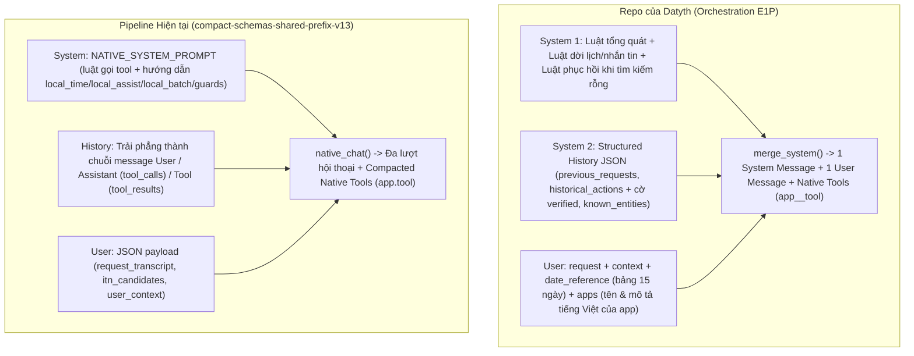

# Báo cáo So sánh Pipeline LLM: Hiện tại vs. `Datyth/ZaloAI-Challenge-lifemate`

Báo cáo này phân tích chi tiết sự khác biệt **chỉ riêng ở tầng LLM** (kiến trúc suy luận, thiết kế prompt/schema, cơ chế giải quyết ngữ cảnh/thời gian, vòng lặp agent & hậu kiểm, quy trình xây dựng dữ liệu SFT và chiến lược huấn luyện LoRA) giữa **Pipeline hiện tại** (`code/`) và **Repo của Datyth** ([https://github.com/Datyth/ZaloAI-Challenge-lifemate](https://github.com/Datyth/ZaloAI-Challenge-lifemate) — đạt **61.26** điểm Public Test).

---

## 1. Bảng Tóm tắt Đối chiếu Nhanh

| Hạng mục LLM | `Datyth/ZaloAI-Challenge-lifemate` | Pipeline Hiện tại (`code/`) |
| :--- | :--- | :--- |
| **Base Model** | `Qwen/Qwen3.5-4B` (text-only, `enable_thinking=False`, greedy `temp=0`, `max_len=16384`) | `Qwen/Qwen3.5-4B` (text-only qua `AutoModelForImageTextToText`, `enable_thinking=False`, greedy `temp=0`, `max_len=16384`) |
| **Inference Engine** | **vLLM Server** (`v0.32.0`, OpenAI-compatible HTTP API), hỗ trợ chạy đa luồng (4 shards) & multi-LoRA | **In-process HF Transformers + PyTorch SDPA** (`LocalLLM`), chạy tuần tự từng sample trên 1 GPU |
| **Cơ chế Caching** | Prefix caching tự động của vLLM | **3 tầng Cache tự viết** cho kiến trúc lai GatedDeltaNet: `InferenceSession` (CPU) + `PrefixCache` (GPU in-sample + observation chain) + `SchemaCache` (GPU cross-sample kèm gom nhóm sample theo `installed_apps`) |
| **Định dạng Tool Call** | Native Qwen3.5 (`qwen3_coder`), đổi tên hàm `app.tool` $\rightarrow$ `app__tool`, dừng khi trả về nội dung rỗng `" "` | Native Qwen3.5 XML (`<tool_call><function=app.tool>...`) qua `native_chat`, giữ nguyên dấu chấm `app.tool`, dừng bằng chuỗi JSON `{"action":"done"}` |
| **Xử lý Lịch/Giờ & ITN** | **Tiền tính toán (Zero-turn):** Bơm thẳng bảng lịch 15 ngày (`date_reference`) và tên/mô tả tiếng Việt của app (`context.apps`) vào user message đầu tiên | **Tool-based + Pre-ITN:** Bơm sẵn `itn_candidates` vào prompt + cung cấp **8 nhóm Python Specialist Tools** (`local_time.*`, `local_assist.solve`, `local_entity.resolve`, `local_text.normalize`...) để LLM gọi thêm lượt nội bộ |
| **Số lệnh mỗi lượt LLM** | 1 tool call / lượt (tối đa 10 lượt) | 1 tool call hoặc **1 Batch** qua `local_batch.run` (gộp nhiều local helpers hoặc 2–4 lệnh `read` độc lập vào 1 lượt LLM) |
| **Kiểm duyệt & Chống lặp** | Xóa filter rỗng của lệnh `read`, xóa `location` mặc định của `weather.*`, **chặn cứng `x-ref`** nếu ID chưa xuất hiện, khóa read tool sau 2 lần trả về rỗng (`retry_cap=2`) | Không sửa tham số của model, quản lý chống lặp theo **`state_epoch`** trong `LoopMonitor` (cho phép gọi lại sau khi `write` đổi state), dọn observation bị từ chối sau khi có call thành công |
| **Đơn vị mẫu SFT** | **1 Quỹ đạo (Trajectory) = 1 mẫu SFT** (tính loss trên mọi lượt `assistant` trong cùng 1 lần forward) | **1 Bước quyết định (Step) = 1 mẫu SFT riêng biệt** (mỗi bước lặp lại toàn bộ prompt prefix từ đầu) |
| **Pha trộn Transcript SFT** | **200% dữ liệu:** Mỗi sample tạo cả 2 bản (`100% Gold` + `100% ASR` viết thường) | **100% dữ liệu (50:50):** Chia ngẫu nhiên 50% sample IDs dùng `audio_text`, 50% dùng `asr` |
| **Dữ liệu Bổ sung SFT** | **Recovery Trajectories (`inject_recovery.py`):** Chèn 92 quỹ đạo tìm kiếm thất bại (`train: False`, không tính loss) rồi tự sửa lại câu truy vấn đúng | **Synthetic Helper Demos:** Tự động chèn các bước gọi `local_time.*`, `local_assist.solve`, `local_entity.*` trước bước gọi tool chính và gom nhóm bằng `local_batch.run` |
| **Tổng quát hóa App lạ** | Bơm tên & mô tả tiếng Việt của từng app từ catalog vào `context.apps` (`E1P`) + tập `synth/` (27 app giả lập mới) | `AppAugmenter`: Tạo thêm 2 biến thể đổi tên ẩn danh (`app_17.tool_42`) + chèn 1–3 app nhiễu (distractor apps) |
| **Hàm Loss khi Train** | **Token-Weighted CE (`--fuzzy-weight 0.3`):** Giảm trọng số loss của các tham số văn bản tự do (`x-match: fuzzy`) xuống `0.3` + chỉ tính logits phần completion | **Standard Assistant CE:** Mọi token của assistant ở bước đích đều có trọng số `1.0` |
| **Ensemble** | Hỗ trợ **Step-level Majority Voting** giữa 3 LoRA adapters (`p1`, `e1`, `synth`) trên cùng 1 `ToolEnv` | Đơn mô hình (1 Base + 1 LoRA adapter) |

---

## 2. Phân tích Chi tiết Từng Thành phần

### 2.1. Hạ tầng Suy luận (Inference Engine) & Tối ưu Bộ nhớ Đệm (Caching)

* **Repo của Datyth:**
  * Tách LLM thành một tiến trình **vLLM OpenAI-compatible Server** độc lập (`vllm/vllm-openai:v0.32.0`) với cờ `--language-model-only` (loại bỏ hoàn toàn nhánh thị giác của Qwen3.5 ngay lúc nạp), `--enable-auto-tool-choice --tool-call-parser qwen3_coder --reasoning-parser qwen3`.
  * Client `LocalChat` rất gọn nhẹ (~57 dòng), chỉ gửi HTTP request tới `127.0.0.1:8000`.
  * Việc tận dụng vLLM giúp họ hưởng lợi trực tiếp từ PagedAttention, Automatic Prefix Caching và khả năng chạy 4 luồng (shards) song song hoặc truy vấn 3 LoRA adapters cùng lúc trong một bước bầu chọn (ensemble).

* **Pipeline hiện tại:**
  * Chạy trực tiếp trong tiến trình Python bằng **HuggingFace Transformers (`5.4.0`) + PyTorch SDPA** qua lớp `LocalLLM` và `model_loader` (`AutoModelForImageTextToText`).
  * Vì không dùng vLLM, pipeline hiện tại tự xây dựng một hệ thống tối ưu hóa suy luận rất công phu cho kiến trúc lai (Hybrid Attention + Linear Attention `Qwen3_5GatedDeltaNet`) của Qwen3.5:
    1. **Vá lỗi tiếp nối trạng thái của HF 5.4.0 (`prefix_cache.py`):** Trong Transformers 5.4.0, lớp `Qwen3_5GatedDeltaNet.forward` chỉ nối tiếp trạng thái đệ quy (`recurrent_states` và `conv_states`) khi `seq_len == 1`. Hàm `_continue_qwen54_chunk` tự viết lại phép chiếu và truyền `initial_state` vào `chunk_gated_delta_rule` để có thể nạp prefix cache cho một đoạn hậu tố nhiều token (`seq_len > 1`).
    2. **3 tầng Cache (`PromptCache` + `PrefixCache` + `SchemaCache`):**
       * `InferenceSession` giữ chuỗi JSON cố định và token IDs của phần đầu cuộc hội thoại trên CPU, chỉ tokenize lại phần `observations` mới sinh ra.
       * `PrefixCache` không chỉ lưu snapshot tĩnh của sample mà còn duy trì một chuỗi `chain` tiến dần qua các `executed_observation_run` (`committed_prefix_ids`), giúp lượt thứ $k$ chỉ cần prefill thêm kết quả của lượt $k-1$.
       * `SchemaCache` kết hợp với `schedule_by_schema` trong `main.py` sắp xếp lại các sample có cùng tập `installed_apps` chạy cạnh nhau để tái sử dụng trạng thái GPU của phần `system + tools` xuyên qua các sample khác nhau.
    3. **Cơ chế dừng sớm theo bảng lọc từ vựng (`decoding.py`):** Xây dựng bảng tra byte `_closing_token_table` đánh dấu mọi token có chứa ký tự `}` hoặc `>` để bỏ qua bước giải mã chuỗi ở các token thông thường, và ngắt `model.generate()` ngay khi đóng thẻ `</tool_call>` hoặc JSON `{"action":"done"}`.

---

### 2.2. Thiết kế Prompt, Biểu diễn Lịch sử & Giao thức Function Calling

* **Nội dung System Prompt & Ngữ cảnh bổ trợ:**
  * **Datyth (`src/lifemate/agent.py`):**
    * Phát triển qua 3 thế hệ prompt (`E1` $\rightarrow$ `E1D` $\rightarrow$ `E1P`). Bản release `E1P` đưa trực tiếp các quy tắc nghiệp vụ rút ra từ phân tích lỗi vào prompt:
      * Quy tắc phân biệt công cụ: *"Dời lịch cần tìm sự kiện bằng `calendar.list_events` rồi `calendar.update_event`... Nhắn [người] cần tìm người qua `contacts.search` rồi gửi bằng `sms.send` nếu SMS đã cài; không thay bằng `reminders.create`."*
      * Quy tắc xử lý tìm kiếm rỗng: *"Thử lại với từ khoá ngắn hơn (bỏ danh xưng, chỉ giữ tên chính), bỏ trống query để liệt kê, hoặc dùng tool danh sách của app; không đưa ngày giờ vào ô từ khoá..."*
      * Bổ sung trường `context.apps` lấy từ catalog (ví dụ `"ewallet": "Ví điện tử: Quản lý số dư, chuyển tiền..."`) vì người dùng Việt hay nói *"kiểm tra bên ví"*, *"mở app nhắc việc"* thay vì tên tiếng Anh của namespace.
  * **Pipeline hiện tại (`agent.py`, `function_calling.py`):**
    * Giữ prompt hoàn toàn tổng quát, **tuyệt đối không nhắc tên bất kỳ app cụ thể nào** (ngoài `sys.ask_missing_info` và các tool nội bộ `local_*`) để đảm bảo tính cô lập khi kiểm định unseen apps (`split_generalization` kiểm tra `global_refs` và báo lỗi nếu system prompt chứa tên app trong catalog).
    * Không đưa tên/mô tả tiếng Việt cấp độ app (`app.name`, `app.description`) vào `user_context`, mà chỉ đưa mô tả của từng tool (đã qua bước nén `compact_tool_schema`).

* **Biểu diễn History:**
  * **Datyth (`history.py`):** Tóm tắt toàn bộ lịch sử thành một đối tượng JSON chỉ đọc (`previous_requests`, `historical_actions`, `known_entities`) gắn sẵn nhãn `"verified": true/false` cho từng hành động lịch sử và nhúng vào system message.
  * **Pipeline hiện tại (`function_calling.py`):** Tái tạo lại lịch sử thành các lượt message `user` / `assistant` (`tool_calls`) / `tool` (`tool_results`) theo đúng định dạng native chat template của Qwen3.5.

---

### 2.3. Giải quyết Ngày giờ, Số học & Thực thể: Bơm sẵn vào Context vs. Gọi Python Helpers

* **Cách của Datyth — Tiền tính toán & Không tốn lượt LLM (Zero-turn Context Injection):**
  * Một mô hình 4B thường tính nhầm *"thứ ba tuần sau"* hoặc *"thứ sáu"* lệch 1 ngày. Thay vì bắt model gọi tool tra lịch, hàm `date_reference` của Datyth tính sẵn danh sách 15 ngày (`hôm qua` $\rightarrow$ `+13 ngày` kèm thứ tiếng Việt) cùng khoảng ngày `this_week` và `next_week` rồi gắn thẳng vào `context["date_reference"]` trong prompt đầu tiên.
  * Nhờ vậy, LLM đọc ngay ngày tháng từ prompt và phát lệnh gọi tool ứng dụng ngay ở lượt 1.

* **Cách của Pipeline hiện tại — Hệ sinh thái Python Specialist Tools & Task Orchestrator:**
  * Pipeline hiện tại cung cấp một bộ công cụ Python nội bộ phong phú (`local_helpers.py`, `local_time.py`, `local_assist.py`, `local_knowledge.py`, `local_checks.py`):
    * `local_time.calendar_reference`, `local_time.departure_time`, `local_time.duration_between`.
    * `local_assist.solve`: giải quyết trọn gói các tác vụ `date`, `datetime`, `departure_time`, `duration`, `normalize_fields` từ văn bản tiếng Việt (ví dụ nhận `"sáng mai"`, `"chín giờ"`, `travel_minutes=15` $\rightarrow$ trả về ISO timestamp hoàn chỉnh).
    * `local_context.lookup` & `local_entity.resolve`: tra cứu thông tin từ profile/history.
    * `local_checks.evaluate`: tính tổng, hiệu, nhân, chia, phần trăm, so sánh số học chính xác bằng Python.
    * Bên cạnh đó, `itn.py` trích xuất sẵn `itn_candidates` (số tiền, SĐT, email) đưa vào prompt ngay từ đầu.
  * **Đánh đổi (Trade-off):** Các helper Python giúp tính toán chính xác tuyệt đối (như trừ số phút di chuyển, cộng tiền, đổi giờ), nhưng **đòi hỏi LLM phải tốn thêm ít nhất 1 lượt sinh (planning turn)** để gọi helper trước khi gọi tool ứng dụng (dù đã được giảm thiểu nhờ gom nhóm qua `local_batch.run` và `local_assist.solve`). Trong khi đó, với tác vụ tra thứ/ngày thông thường, việc bơm sẵn `date_reference` vào context như Datyth không tốn thêm bất kỳ lượt sinh nào của LLM.

---

### 2.4. Vòng lặp Agent, Kiểm duyệt & Chống lặp (Validation & Guards)

* **Tiền xử lý Tham số & Kiểm tra `x-ref`:**
  * **Datyth (`src/lifemate/agent.py`):**
    1. **Tự động lọc bỏ tham số rỗng:** Với mọi read tool, nếu model truyền tham số không bắt buộc có giá trị `None`, `""`, `[]`, `{}` thì tự động loại bỏ khỏi `args`.
    2. **Luật đặc thù cho `weather.*`:** Nếu model truyền `location` trùng với thành phố trong `user_profile.city` nhưng người dùng không nói tên thành phố đó trong `transcript`, tự động xóa `location` khỏi `args` (do quy ước của bộ dữ liệu là dùng giá trị mặc định khi không nói rõ).
    3. **Cổng kiểm duyệt `x-ref` cứng:** Trước khi gọi `env.call`, kiểm tra mọi tham số có khai báo `x-ref` trong schema. Nếu giá trị ID truyền vào chưa từng xuất hiện trong tập `observed_ids` (thu thập từ kết quả tool trong history hoặc các bước read trước đó của cùng ứng dụng), agent **từ chối thực thi ngay** và trả lỗi `"<key> must come from an observed <ref> ID; call a read tool first"`.
  * **Pipeline hiện tại (`tool_execution.py`, `execution_policy.py`):**
    * Không tự ý chỉnh sửa/cắt bỏ `args` của model.
    * Kiểm tra tên tool (`check_tool_access` — kèm gợi ý fuzzy match nếu gõ sai tên) và gọi `env.validate(name, args)`. Không chặn cứng `x-ref` bằng tập ID trong Python (vì `env.validate` chỉ kiểm tra kiểu dữ liệu/schema, còn ID không tồn tại khi vào `env.call` sẽ trả về `ok: True, done: False` và ghi vào log chấm điểm).

* **Chống lặp (Deduplication) & Giới hạn Thử lại (Retry Cap):**
  * **Datyth:**
    * `dedup_calls=True`: Chặn tuyệt đối việc gọi lại cùng `(name, args)` trong toàn bộ sample.
    * `retry_cap=2`: Đếm số lần một read tool trả về rỗng (`_empty_result`). Nếu một read tool trả về rỗng **2 lần** (dù với các từ khóa `query` khác nhau), chặn hoàn toàn read tool đó ở các lượt tiếp theo để tránh việc model rơi vào vòng lặp tìm kiếm vô tận (ví dụ thử tìm chuyến bay qua 10 ngày liên tiếp), ép model phải gọi `sys.ask_missing_info` hoặc dừng.
  * **Pipeline hiện tại (`LoopMonitor`):**
    * Thiết kế theo cơ chế **`state_epoch`**:
      * Chặn lặp lại cùng `(name, args)` đối với các lệnh `read` hoặc lệnh `write` không thành công (`done: False`) trong cùng một `state_epoch`.
      * Khi có một lệnh `write` thực thi thành công (`done != False`), `state_epoch` tăng lên và xóa bộ nhớ chặn `read`, cho phép đọc lại dữ liệu sau khi trạng thái đã thay đổi.
      * Cho phép lặp lại lệnh `write` thành công nhiều lần (hợp lệ với các tác vụ như đổi 2 voucher cùng loại).
    * Không có `retry_cap` khóa read tool theo tên hàm khi thay đổi tham số `query`.
    * **Cơ chế dọn dẹp Observation lỗi:** Trong `agent.py`, ngay khi một lời gọi thực thi thành công, mọi phản hồi từ chối (`rejected` proposals không có trường `result`) trước đó sẽ bị xóa khỏi `observations`, giúp làm sạch ngữ cảnh và giữ cho `PrefixCache` nối chuỗi liên tục.

---

### 2.5. Xây dựng Dữ liệu SFT & Tăng cường Dữ liệu (SFT Data & Augmentation)

1. **Cách đóng gói mẫu SFT (Full-Trajectory vs. Step-wise Expansion):**
   * **Datyth (`prepare_agent_sft.py`, `train_agent_sft.py`):**
     * Lưu **cả quỹ đạo nhiều lượt (multi-turn trajectory) thành 1 dòng SFT duy nhất**.
     * Trong `train_agent_sft.py`, họ dùng `return_offsets_mapping=True` và regex `SPAN` để tìm tất cả các đoạn `<|im_start|>assistant...<|im_end|>` trong chuỗi văn bản đã render, gán nhãn `labels` cho mọi lượt `assistant` đồng thời (và kiểm tra nghiêm ngặt rằng tiền tố trước mỗi lượt assistant khớp 100% với `add_generation_prompt=True` lúc inference).
     * **Lợi ích:** Nếu một quỹ đạo có 4 bước gọi tool và prompt đầu dài 6,000 tokens, cách của Datyth chỉ đưa chuỗi ~6,500 tokens qua mạng **1 lần**, thay vì lặp lại 6,000 tokens đó 4 lần ở 4 mẫu riêng biệt.
   * **Pipeline hiện tại (`sft.py`):**
     * Mỗi bước quyết định (`step`) trong quỹ đạo được xuất thành **1 mẫu SFT độc lập** gồm 3 message `[system, user, assistant]`, trong đó các bước đã chạy trước đó nằm trong `user` (`previous_actions_and_results`), sau đó được `native_chat` bung ra thành chuỗi message và chỉ tính loss ở lượt `assistant` cuối cùng (`encode_example`).

2. **Tỷ lệ kết hợp Transcript chuẩn (`audio_text`) và ASR (`asr`):**
   * **Datyth:** Tạo **cả 2 bản cho tất cả 1,545 mẫu train** (`--variants gold,asr` $\rightarrow$ 3,090 quỹ đạo). Như vậy mọi tác vụ đều được học cả trong điều kiện văn bản chuẩn lẫn văn bản bị lỗi ASR thực tế.
   * **Pipeline hiện tại (`assign_transcript_sources`):** Chia ngẫu nhiên theo sample ID với tỷ lệ mặc định `0.5` (50% số sample chỉ học bản `audio_text`, 50% số sample chỉ học bản `asr`), trừ khi đi qua `AppAugmenter`.

3. **Dạy mô hình Phục hồi sau Tìm kiếm Rỗng (`inject_recovery.py`) — Điểm sáng của Datyth:**
   * Datyth phát hiện một điểm mù lớn của tập TRAIN: trong nhãn gold của TRAIN, hầu như mọi lệnh tìm kiếm (`contacts.search`, `maps.search_place`...) đều trả về kết quả ngay lần đầu, trong khi lúc chạy thực tế trên Public Test (đặc biệt với ASR nhiễu và unseen apps), **75/634 mẫu** gặp kết quả tìm kiếm rỗng ở lần đầu tiên khiến mô hình bị đứng hoặc lặp lại đúng câu tìm kiếm cũ.
   * Họ viết `scripts/data/inject_recovery.py` để tạo ra **92 quỹ đạo phục hồi** (nhân đôi thành 184 dòng trong tập train `p1`) với 3 kịch bản lỗi thực tế chạy qua `ToolEnv` thật:
     * `honorific`: Thêm danh xưng có trong lời nói vào trước tên khi tra danh bạ (ví dụ tìm `"anh Dũng"` trả về rỗng $\rightarrow$ lượt sau bỏ danh xưng, tìm `"Dũng"`).
     * `asr_name`: Tìm theo cụm từ tên riêng bị ASR nghe sai (trả về rỗng) $\rightarrow$ lượt sau chỉ tìm từ cuối của tên hoặc truyền `query` rỗng `{}` để liệt kê toàn bộ danh bạ.
     * `long_query`: Câu truy vấn bị dính thêm từ liền kề trong câu nói $\rightarrow$ lượt sau rút gọn về từ khóa chuẩn.
   * Đặc biệt, lượt gọi tìm kiếm thất bại được gắn `"train": False` (mask loss = `-100`), nên mô hình **chỉ học hành động phục hồi sau khi thấy kết quả rỗng**, không bị học thói quen tạo truy vấn sai.
   * **Pipeline hiện tại:** Chưa có dữ liệu SFT dạy hành vi thử lại với truy vấn ngắn hơn sau khi `ToolEnv` trả về kết quả rỗng (chỉ có hướng dẫn bằng lời trong prompt).

4. **Augmentation cho Unseen Apps:**
   * **Pipeline hiện tại (`data_generalization.py`):** Mặc định sinh thêm 2 biến thể đổi tên ẩn danh (`app_17.tool_42`) + chèn 1–3 distractor apps cho mỗi mẫu train, khiến số lượng bước SFT tăng lên gấp ~3 lần.
   * **Datyth:** Thử nghiệm đổi tên namespace (`--rename-apps`) trên bài toán giấu 6 app (Leave-Apps-Out) nhưng thấy điểm trên unseen apps giảm `-1.1` nên **không dùng** trong bản chính; thay vào đó họ dùng `context.apps` (mô tả tiếng Việt của app) cho adapter chính `p1`, và xây dựng bộ dữ liệu **Synthetic Apps (`synth/`)** gồm 27 app mới hoàn toàn để train một adapter riêng (`llm-lora-synth`) phục vụ ensemble.

---

### 2.6. Chiến lược Huấn luyện LoRA, Hàm Loss & Ensemble

* **Hàm Loss có Trọng số (Token-Weighted Loss) — Khác biệt quan trọng:**
  * **Datyth (`WeightedLossTrainer` trong `train_agent_sft.py`):**
    * Qua phân tích `analysis/token_loss.py`, họ nhận thấy các tham số văn bản tự do có `"x-match": "fuzzy"` trong schema (ví dụ: nội dung tin nhắn `message`, tiêu đề sự kiện, nội dung ghi chú) chỉ chiếm **4–6% số token được train**, nhưng lại chiếm tới **42–66% tổng giá trị hàm loss** trên tập validation (vì có nhiều cách diễn đạt câu chữ khác nhau, trong khi metric của BTC chỉ cần F1 từ vựng $\ge 0.5$).
    * Do đó, họ cài đặt `WeightedLossTrainer` với `--fuzzy-weight 0.3`: giảm trọng số gradient của mọi token nằm trong giá trị `<parameter=...>` có `x-match == "fuzzy"` xuống **0.3**, giữ nguyên trọng số **1.0** cho tên tool, cấu trúc XML và các tham số exact-match (ID, ngày giờ, số tiền, enum).
    * Đồng thời, họ dùng `UNSLOTH_RETURN_HIDDEN_STATES=1` kết hợp `logits_to_keep` để **chỉ chạy lớp chiếu từ vựng (`lm_head`) trên đúng các token của assistant** (vốn chỉ chiếm <10% tổng số token của chuỗi), giúp tiết kiệm bộ nhớ GPU và tăng tốc độ train đáng kể.
  * **Pipeline hiện tại (`train_lora.py`):**
    * Sử dụng hàm loss Cross-Entropy đồng nhất (mọi token của assistant đều có trọng số `1.0`), chưa tách trọng số cho các trường `x-match: fuzzy` và chưa dùng `logits_to_keep` để cắt bỏ việc tính logits ở phần prompt.
    * Đổi lại, pipeline hiện tại có lớp bảo vệ số học `NumericsGuard` rất chặt chẽ để bắt lỗi `NaN/Inf` của gradient trước khi optimizer cập nhật trọng số, và nhắm mục tiêu LoRA vào cả các lớp chiếu của `GatedDeltaNet` (`in_proj_qkv`, `in_proj_z`, `out_proj`) bên cạnh các lớp Attention/MLP truyền thống (`lora_targets`).

* **Siêu tham số Huấn luyện (Hyperparameters):**
  * **Datyth (`p1`):** `epochs = 2`, `lr = 1e-4`, `weight_decay = 0.0`, `optim = "adamw_8bit"`, `warmup_steps = 10`, không dùng app renaming augmentation.
  * **Pipeline hiện tại:** `epochs = 3`, `lr = 2e-4`, `weight_decay = 0.01`, `optim = "adamw_torch"`, `warmup_steps = 0.03`, có bật app renaming augmentation (`--rename-variants 2`). *(Lưu ý: Với dữ liệu đã nhân 3 lần qua augmentation và chạy 3 epochs ở `lr = 2e-4`, số bước cập nhật trên mỗi quỹ đạo gốc lớn hơn rất nhiều so với Datyth).*

* **Step-Level Ensemble trên 1 `ToolEnv`:**
  * **Datyth (`src/lifemate/ensemble.py`):** Thiết kế `EnsembleChat` bọc ngoài `LocalChat` để ở mỗi bước trong vòng lặp agent, gửi đồng thời lịch sử hiện tại tới 3 LoRA adapters khác nhau (`p1` dùng prompt `E1P`, `e1` dùng prompt `E1`, `synth` dùng prompt `E1`), chuẩn hóa đề xuất `(tool_name, sorted_args)` hoặc `STOP` và lấy theo đa số phiếu bầu trước khi gọi vào `ToolEnv` duy nhất của sample.
  * **Pipeline hiện tại:** Chưa có cơ chế ensemble ở bước suy luận.

---

## 3. Nhận xét & Gợi ý Cải tiến cho Pipeline Hiện tại

Nếu muốn chắt lọc các kỹ thuật hiệu quả nhất từ `Datyth/ZaloAI-Challenge-lifemate` để nâng cấp phần LLM của pipeline hiện tại, các điểm đáng cân nhắc nhất theo thứ tự ưu tiên gồm:

1. **Giảm trọng số Loss cho các trường văn bản tự do (`x-match: fuzzy` weight = `0.3`) & `logits_to_keep`:** Tránh việc LoRA tốn phần lớn dung lượng học vẹt câu chữ tin nhắn/ghi chú thay vì học cách chọn đúng tool và tham số exact-match.
2. **Bổ sung Recovery Trajectories (`train: False` trên lượt tìm kiếm lỗi):** Giúp model biết cách tự rút gọn từ khóa (bỏ danh xưng, lấy tên chính hoặc liệt kê) khi kết quả tìm kiếm trả về rỗng thay vì dừng sớm hoặc lặp lại.
3. **Bơm sẵn `date_reference` và thông tin tiếng Việt của ứng dụng (`context.apps`) vào Prompt:** Giúp giải quyết nhanh các tham chiếu ngày/thứ trong tuần và tên gọi app tiếng Việt (*"bên ví"*, *"nhắc việc"*) ngay từ lượt đầu mà không bắt buộc tốn thêm một lượt gọi helper Python.
4. **Đóng gói SFT theo toàn quỹ đạo (Full-Trajectory SFT) & dùng đủ 100% Gold + 100% ASR:** Giảm mạnh thời gian train (không phải forward lại phần prompt 5k–10k tokens ở từng bước nhỏ) và đảm bảo mọi mẫu train đều được nhìn thấy cả bản sạch lẫn bản nhiễu ASR.
5. **Thêm `retry_cap=2` cho các lệnh đọc trả về rỗng và kiểm tra `x-ref` từ tập ID đã quan sát:** Ngăn chặn hiệu quả việc model tiêu tốn hết lượt gọi vào một công cụ tìm kiếm không có kết quả hoặc đoán mò ID trước khi gọi lệnh đọc.
