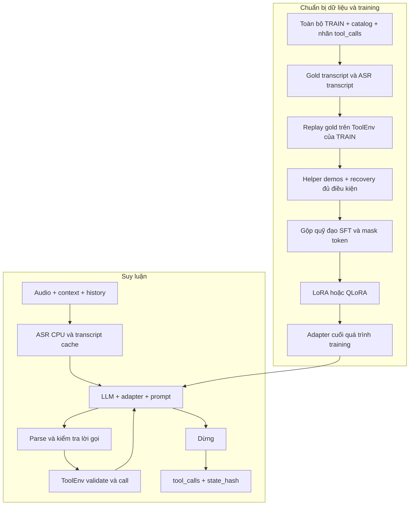

# Báo cáo chi tiết pipeline LifeMate

**Ngày lập:** 10/11/2026.  
**Phạm vi:** mã nguồn hiện có trong `code/`, dữ liệu manifest trong `train+public_test/`, pipeline chuẩn bị dữ liệu, training LLM, suy luận và xuất kết quả.  
**Phương pháp:** đọc trực tiếp mã nguồn trong working tree. Các thông số dưới đây là cấu hình được khai báo trong mã, không phải kết quả benchmark của một lần chạy mới.

## 1. Chức năng và kiến trúc tổng thể

LifeMate nhận yêu cầu giọng nói tiếng Việt, kết hợp ngữ cảnh và lịch sử hội thoại, sau đó dùng LLM để lựa chọn công cụ ứng dụng. Công cụ được kiểm tra và thực thi trên `ToolEnv` đi kèm đúng split dữ liệu. Kết quả cuối cùng gồm các lời gọi đã thực thi và hash trạng thái do chính môi trường trả về.

Hệ thống có hai luồng chính:



Các đặc điểm quyết định hành vi hiện tại:

- Pipeline training đưa toàn bộ source sample vào partition `train`, không giữ riêng validation hay app-held-out.
- Training không chạy validation loss, rollout cuối epoch hoặc evaluation sau khi train.
- Adapter xuất ra là trạng thái sau `trainer.train()`, không phải checkpoint được chọn bằng điểm validation.
- Với mặc định CLI hiện tại, một mẫu TRAIN thường có cả bản transcript Gold và bản transcript ASR.
- Với Qwen3.5 native function calling, mặc định gộp mỗi quỹ đạo thành một dòng SFT và học các lượt assistant hợp lệ trong quỹ đạo đó.
- Suy luận hiện dùng Transformers và PEFT trong tiến trình Python; entrypoint `LocalLLM` chưa triển khai backend vLLM.

## 2. Dữ liệu đầu vào và hợp đồng với ToolEnv

### 2.1. Bố cục dữ liệu

```text
train+public_test/
├── train/
│   ├── train.jsonl
│   ├── train_tools_catalog.json
│   ├── zaic_tools.py hoặc package zaic_tools/
│   ├── các file audio
│   └── train_environment/ ...
└── public_test/
    ├── public_test.jsonl
    ├── public_test_tools_catalog.json
    ├── zaic_tools.py hoặc package zaic_tools/
    ├── các file audio
    └── public_test_environment/ ...
```

Đếm dòng manifest tại thời điểm lập báo cáo: `train.jsonl` có **1.545 dòng**, `public_test.jsonl` có **634 dòng**. Đây là số dòng trên đĩa, chưa phải số dòng SFT sau mở rộng quỹ đạo.

`resolve_data_layout()` chấp nhận `--data-root` trỏ đến thư mục cha hoặc trực tiếp thư mục split. Trường hợp trỏ trực tiếp vào split, hàm tạo liên kết thư mục tạm để cung cấp đúng cấu trúc root cho `ToolEnv`.

Mã ứng dụng không trực tiếp mở hay phân tích nội dung `*_environment/`; việc truy cập trạng thái thuộc về `ToolEnv` của bộ dữ liệu.

### 2.2. Cấu trúc một mẫu

| Trường | Vai trò |
|---|---|
| `id` | Định danh mẫu; dùng để ghép transcript, dữ liệu SFT và kết quả. |
| `audio` | Đường dẫn audio yêu cầu hiện tại, tương đối với thư mục split. |
| `audio_text` | Transcript có sẵn của TRAIN; được dùng theo chế độ chuẩn bị SFT hoặc ablation TRAIN. |
| `context` | Thời gian, múi giờ, vị trí, hồ sơ và ứng dụng/công cụ được cài. |
| `history` | Lịch sử hội thoại, có thể chứa text, audio và bằng chứng về tool đã thực thi. |
| `label.tool_calls` | Chuỗi lời gọi gold theo thứ tự thực thi, chỉ dùng trong quá trình chuẩn bị TRAIN. |

Nhãn thiếu hoặc schema gold không hợp lệ là lỗi chuẩn bị dữ liệu. Danh sách gold rỗng có thể tạo quỹ đạo helper phù hợp rồi kết thúc bằng `done`. Các file test không được dùng nhãn để training.

Đường dẫn audio được resolve và kiểm tra để không thoát khỏi thư mục split.

### 2.3. Catalog và quyền gọi tool

`load_catalog()` đọc schema công cụ, giữ metadata ứng dụng trong `_app` và bảo đảm có `sys.ask_missing_info`. `allowed_tools()` chỉ chọn các tool được phép theo `context.installed_apps`.

Metadata tên tiếng Việt và mô tả ứng dụng được đưa vào `user_context.apps`. Bản schema dùng trong prompt chỉ lược một số dữ liệu dư thừa, ví dụ `_app`, trường `app` trùng namespace, `returns` rỗng và mô tả integer lặp lại đúng mẫu cố định. Các ràng buộc như `required`, `enum`, `x-ref`, `x-match` và cấu trúc tham số vẫn được giữ.

Nguồn: [main.py](code/main.py), [catalog.py](code/lifemate/catalog.py), [schema_prompt.py](code/lifemate/schema_prompt.py).

## 3. Các thành phần chính

| Thành phần | File | Trách nhiệm |
|---|---|---|
| Điều phối fine-tune | [finetune.py](code/finetune.py) | Chuẩn bị base model, chạy chuẩn bị SFT, training và merge tùy chọn. |
| Chuẩn bị SFT | [prepare_sft.py](code/prepare_sft.py) | Chọn transcript, replay gold, sinh recovery, grouping và ghi manifest. |
| Mã hóa dữ liệu | [sft.py](code/lifemate/sft.py) | Gộp quỹ đạo, mask assistant, gán fuzzy weights và padding. |
| Huấn luyện | [train_lora.py](code/train_lora.py) | Nạp model, gắn LoRA, tính weighted loss, lưu checkpoint và adapter. |
| Điều phối suy luận | [main.py](code/main.py) | Chạy ASR/LLM theo stage, tạo ToolEnv và ghi submission. |
| Nhận dạng tiếng nói | [asr.py](code/lifemate/asr.py) | GIPformer ONNX trên CPU. |
| Cache transcript | [transcripts.py](code/lifemate/transcripts.py) | Lưu, kiểm tra và phục hồi kết quả ASR. |
| Agent | [agent.py](code/lifemate/agent.py) | Vòng lặp quan sát, lên kế hoạch, gọi tool và dừng. |
| Backend LLM | [models.py](code/lifemate/models.py), [llm.py](code/lifemate/llm.py) | Nạp model/adapter, tokenization và generation. |
| Function calling | [function_calling.py](code/lifemate/function_calling.py) | Chuyển portable payload sang native chat và parse output. |
| Biên thực thi | [tool_execution.py](code/lifemate/tool_execution.py) | Kiểm tra quyền, validate, x-ref và gọi ToolEnv. |
| Chống lặp | [execution_policy.py](code/lifemate/execution_policy.py) | Theo dõi call bị từ chối, kết quả đọc và trạng thái tiến triển. |
| Runtime artifact | [runtime.py](code/lifemate/runtime.py) | Ghi fingerprint model/tokenizer và generation policy. |

## 4. ASR và vòng đời transcript cache

### 4.1. Backend ASR

Backend được khai báo là `sherpa-onnx`, model nguồn `g-group-ai-lab/gipformer1.5-68M-rnnt`. ASR chạy trên CPU, không chia sẻ GPU training/suy luận LLM.

| Thuộc tính | Giá trị trong mã |
|---|---|
| Kiểu mô hình | ONNX transducer: encoder, decoder, joiner và `tokens.txt`. |
| Precision mặc định | `int8`; có lựa chọn `fp32`. |
| Số thread mặc định | `4`. |
| Sample rate cấu hình recognizer | `16000`. |
| Feature dimension | `80`. |
| Decoding | `greedy_search`. |
| Cache transcript trong RAM | LRU theo đường dẫn audio, mặc định tối đa 8.192 mục. |
| Batch chuẩn bị SFT | `transcribe_batch()`, mặc định batch size `16` trong `prepare_sft.py`. |

Audio được đọc bằng `soundfile` thành float32, gộp nhiều kênh thành mono và kiểm tra dữ liệu rỗng/không hữu hạn/biên độ. Sample rate gốc được truyền vào stream recognizer. Transcript được chuẩn hóa trước khi sử dụng.

### 4.2. Tách ASR và LLM khi suy luận

`main.py --stage full` chạy hai subprocess nối tiếp:

1. Stage `asr`: tạo hoặc hoàn tất transcript cache cho yêu cầu và history.
2. Tiến trình ASR kết thúc, giải phóng runtime của nó.
3. Stage `llm`: kiểm tra cache hoàn chỉnh rồi nạp LLM; không nạp recognizer GIPformer trong stage này.

Cache gồm `transcripts.jsonl` và manifest tương ứng. Manifest ghi version, policy chuẩn hóa, split, ID/thứ tự mẫu, fingerprint dữ liệu/audio, nguồn ASR và checksum file transcript. Fingerprint dữ liệu sử dụng nội dung manifest mẫu cùng kích thước/mtime audio; phần ASR ghi thông tin file model và phiên bản thư viện.

Khi ASR bị gián đoạn, các file `.partial.jsonl` và `.partial.manifest.json` giữ phần đã hoàn tất. Lần chạy lại chỉ tiếp tục nếu cấu hình còn khớp. LLM từ chối cache chưa hoàn chỉnh, sai ID/thứ tự hoặc sai checksum.

Nguồn: [asr.py](code/lifemate/asr.py), [transcripts.py](code/lifemate/transcripts.py), [main.py](code/main.py).

## 5. Chuẩn hóa và xây dựng prompt

### 5.1. Chuẩn hóa văn bản và history

`normalize_transcript()` áp dụng chung cho ASR, Gold transcript và các lượt history:

1. Chuẩn hóa Unicode NFC.
2. Chuyển chữ thường và gộp khoảng trắng.
3. Viết hoa chữ cái đầu tiên của lượt.
4. Thêm dấu chấm nếu lượt chưa kết thúc bằng dấu câu được hỗ trợ.

Ví dụ minh họa: `"  NHẮC TÔI   ngày mai  "` trở thành `"Nhắc tôi ngày mai."`. Hàm không tự tách câu hay sửa lỗi ngữ nghĩa ASR.

History dùng resolver chung; text có sẵn được giữ theo policy chuẩn hóa, audio thiếu text được đưa qua ASR. Historical tool calls/results được giữ làm bằng chứng, không thực thi lại như hành động mới của yêu cầu hiện tại.

### 5.2. Payload dùng chung

Payload portable chứa:

```json
{
  "request_transcript": "Yêu cầu đã chuẩn hóa.",
  "itn_policy": "...",
  "automatic_execution_policy": "...",
  "itn_candidates": [],
  "itn_history_candidates": [],
  "user_context": {},
  "conversation_history": [],
  "available_tools": {"tool_index": [], "tool_schemas": []},
  "previous_actions_and_results": []
}
```

`user_context` có thể được bổ sung:

- `date_reference`: 15 ngày từ hôm qua đến ngày thứ 13 sau hôm nay, kèm thứ tiếng Việt, khoảng tuần này và tuần sau. Mốc thời gian lấy từ context của mẫu.
- `apps`: tên và mô tả ứng dụng có tool được phép dùng.
- ITN candidates nằm ở cấp payload: các đoạn email, số điện thoại, số tiền đã nhận diện/chuẩn hóa, kèm nguồn để model đối chiếu.

ITN và bảng lịch cung cấp dữ kiện tính sẵn; chúng không tự tạo ý định hoặc thực thi hành động ứng dụng. Mặc định chuẩn bị SFT không thêm lại các date helper demo đơn giản; có thể bật bằng `--include-date-helpers`.

### 5.3. Native function calling và JSON fallback

Với model có `model_type=qwen3_5`:

- Dùng chat template của checkpoint, `enable_thinking=False`.
- Chuyển schema sang `tools=...` của template.
- Bỏ `available_tools` khỏi request JSON trong native chat để tránh chép thêm một bản tool index/schema trong user message.
- Chuyển các call/result thành lượt assistant có `tool_calls` và lượt `tool` tương ứng.
- Parse output function calling native về quyết định nội bộ `{action, name, arguments}`.

Output native có dạng minh họa sau; production để template checkpoint quyết định cách render:

```xml
<tool_call>
<function=contacts.search>
<parameter=query>
Dũng
</parameter>
</function>
</tool_call>
```

Quyết định dừng hiện vẫn là `{"action":"done"}`. Model không thuộc nhánh Qwen3.5 dùng giao thức JSON portable. Parser từ chối mảng call cấp cao nhất và yêu cầu dùng `local_batch.run` khi muốn nhóm các thao tác được hỗ trợ.

Nguồn: [prompt_session.py](code/lifemate/prompt_session.py), [function_calling.py](code/lifemate/function_calling.py), [history.py](code/lifemate/history.py), [itn.py](code/lifemate/itn.py), [text.py](code/lifemate/text.py).

## 6. Pipeline training từ đầu đến cuối

### 6.1. Điều phối bằng `finetune.py`

Luồng thực hiện:

1. Đọc tham số, chọn một GPU và kiểm tra giới hạn context.
2. Bảo đảm `validation_fraction=0`, không bật held-out app/group.
3. Yêu cầu thư mục run mới rỗng; resume đi qua `train_lora.py`.
4. Nếu base model là thư mục local, dùng trực tiếp. Nếu là Hugging Face ID, resolve revision thành SHA và tải snapshot trước.
5. Ghi `base_model.json`, rồi chạy các subprocess chuẩn bị/training trong chế độ offline.
6. Chạy `prepare_sft.py`, truyền tokenizer của base model và cấu hình dữ liệu.
7. Chạy `train_lora.py`, sau đó merge nếu có `--export-merged`.

Từng subprocess có log riêng; lỗi ở một stage làm pipeline dừng. ASR chuẩn bị dữ liệu và LLM training nằm ở các subprocess nối tiếp.

### 6.2. Toàn bộ sample thuộc train

Pipeline mặc định có `--validation-fraction 0.0`, `--heldout-apps none`, `--heldout-groups ""`. `split_records(..., 0)` trả toàn bộ mẫu vào train và danh sách validation rỗng. Các partition rỗng được bỏ qua khi ghi dữ liệu.

Vì vậy một lần chuẩn bị thành công theo pipeline này sinh `sft/train.jsonl` và `sft/manifest.json`, không sinh `validation.jsonl`, `app_heldout.jsonl` hay các rollout phục vụ đánh giá.

`--missing-tool-policy error` là mặc định: mẫu lỗi làm quá trình chuẩn bị dừng. Tùy chọn chẩn đoán `skip` có thể loại mẫu lỗi và ghi rõ ID/lý do; khi chủ động dùng tùy chọn này, số mẫu giữ lại có thể thấp hơn số mẫu nguồn.

`prepare_sft.py` vẫn giữ tùy chọn chia tập cho mục đích chẩn đoán độc lập. `finetune.py` không chấp nhận bật các split đó, và `train_lora.py` từ chối manifest còn sample trong partition ngoài train. Điều này ngăn việc vô tình dùng lại SFT cũ đã chia validation.

### 6.3. Gold + ASR: phân biệt `dual` và `mix`

| Cấu hình | Cách tạo dữ liệu TRAIN |
|---|---|
| `--transcript-mode dual`, `0 < ratio < 1` | Mỗi mẫu có bản `audio_text` và bản ASR nếu có Gold transcript. |
| `--transcript-mode mix`, `0 < ratio < 1` | Mỗi mẫu chọn một nguồn theo seed; số mẫu ASR làm tròn từ tỷ lệ cấu hình. |
| `--asr-transcript-ratio 0` | Chỉ dùng Gold transcript cho yêu cầu hiện tại; history chỉ có audio vẫn có thể cần ASR. |
| `--asr-transcript-ratio 1` | Chỉ dùng ASR cho yêu cầu hiện tại. |

Mặc định hiện tại là **`dual` với ratio `0.5`**. Do đó `0.5` trong cấu hình mặc định không có nghĩa chia đôi số source sample: cả hai bản Gold và ASR được tạo cho từng mẫu có transcript sạch. Mẫu thiếu Gold trong dual chỉ tạo bản ASR.

Nếu đủ 1.545 mẫu đều có Gold và ASR, chưa tính recovery/augmentation, có khoảng **3.090 quỹ đạo canonical**. Số dòng JSONL thực tế phụ thuộc format SFT và các quỹ đạo bổ sung; không được đồng nhất số này với optimizer steps.

Mỗi bản transcript được replay trên ToolEnv mới của cùng sample. ASR được chuẩn bị trước theo batch, có cache cho audio trùng. Lỗi ASR không âm thầm thay bằng Gold text.

### 6.4. Replay gold và helper demonstrations

Với mỗi bản transcript:

1. Khởi tạo `ToolEnv("train", sample_id, root=...)`.
2. Xây prompt từ transcript/context/history và tool schema thực sự được phép.
3. Replay gold calls theo thứ tự, qua biên kiểm tra và `env.validate`/`env.call`.
4. Chỉ đưa quan sát đã có ở thời điểm đó vào prompt bước tiếp theo.
5. Sinh helper demonstrations phù hợp khi cần xử lý tính toán, chuẩn hóa hay dữ kiện nội bộ.
6. Kết thúc bằng `done`, hoặc dừng theo nhãn `sys.ask_missing_info`.

Nhãn của bước tương lai không được đưa vào prompt của bước trước. Kết quả tool ứng dụng đến từ ToolEnv, không được dựng từ gold arguments.

Augmentation đổi tên và distractor vẫn có mã hỗ trợ, nhưng CLI hiện mặc định `rename_variants=0`, `distractor_probability=0.0`. Nếu bật, chúng tạo biến thể prompt/target sau canonical replay; alias không được gửi sang ToolEnv như tên tool thật.

### 6.5. Quỹ đạo recovery sau tìm kiếm rỗng

`recovery.py` tạo thêm quỹ đạo đủ điều kiện cho một số search tool, gồm `contacts.search`, `news.search`, `maps.search_place`, `podcast_radio.search`, `library.search`.

Các nguồn tạo truy vấn sai gồm danh xưng, tên bị ASR nhận sai và truy vấn dài hơn từ khóa gold. Quá trình sinh dữ liệu kiểm chứng trên ToolEnv riêng rằng:

- Truy vấn sai thực sự không tìm thấy entity ID theo bộ trích xuất của module.
- Bước phục hồi tìm lại được ít nhất một ID đích từ kết quả canonical.
- Các bước ứng dụng còn lại tái hiện được kết quả cần thiết.

Bước tìm sai được gắn `train=False`. Trong nhánh native encoding, bước này vẫn hiện diện trong context nhưng bị mask khỏi loss; các bước sửa sai tiếp theo được học. Recovery không sinh cho mọi mẫu, và có thể khởi tạo nhiều ToolEnv để probe/tái hiện tình huống.

Mặc định `inject_recovery=True`; dùng `--no-inject-recovery` để tắt. Đây là dữ liệu bổ sung cho TRAIN, không phải rollout validation.

## 7. Format SFT, masking và hàm loss

### 7.1. Full-trajectory SFT

Với tokenizer native Qwen3.5 và không truyền `--step-wise-sft`, quá trình chuẩn bị gọi `collapse_trajectory()` để gộp một quỹ đạo thành một dòng JSONL.

Một dòng vẫn có ba message portable `system/user/assistant`. User payload chứa các quan sát tích lũy của quỹ đạo; khi mã hóa native, chúng được khôi phục thành chuỗi assistant/tool/user feedback nhiều lượt. Các trường đi kèm gồm:

- `sample_id`, `full_trajectory=True`.
- `assistant_train_mask`: xác định lượt assistant nào được học.
- `transcript_source` và metadata augmentation/recovery nếu có.

Đây là gộp các bước của **cùng một quỹ đạo**, không phải nối ngẫu nhiên nhiều sample độc lập vào một chuỗi. Tokenizer fast với offset mapping là điều kiện để mã hóa full-trajectory an toàn.

Với `--step-wise-sft`, giữ từng bước thành dòng riêng. Nhánh non-native cũng không tự bật full-trajectory.

### 7.2. Assistant-only supervision

Encoder xác định span assistant trong rendered chat sau phần request/history. Token của system, user, tool response, padding và lượt assistant bị tắt học nhận `labels=-100`.

Các lượt assistant đang được học có nhãn bằng token ID thật, gồm nội dung đầu ra và marker kết thúc theo span được nhận diện. Encoder kiểm tra số assistant spans khớp mask; không có token được giám sát hoặc không tách được boundary thì báo lỗi.

Prompt/quỹ đạo vượt `--max-length` cũng báo lỗi; mã không cắt âm thầm schema, history, kết quả tool hay target gold để làm vừa chuỗi.

### 7.3. Loss có trọng số cho fuzzy parameters

Mặc định `--fuzzy-weight 0.3`. Với native fast tokenizer, encoder tìm phần giá trị của parameter có schema `x-match="fuzzy"` và gán trọng số thấp hơn:

| Token | Weight |
|---|---|
| Giá trị parameter fuzzy được nhận diện | `0.3` mặc định. |
| Token assistant khác đang được học | `1.0`. |
| Token bị mask/padding | Không đóng góp vào loss. |

Công thức ở mức một batch hoặc nhóm token được chuẩn hóa:

\[
\mathcal{L} = \frac{\sum_{t \in S} w_t\,\mathrm{CE}(z_{t-1}, y_t)}{N_{\mathrm{supervised}}}
\]

Mẫu số là số token được giám sát, hoặc `num_items_in_batch` do Trainer cung cấp cho tích lũy gradient; không phải tổng fuzzy weights. Đặt `--fuzzy-weight 1.0` sẽ tắt giảm trọng số. Nhánh tokenizer không hỗ trợ native span mapping dùng weight `1.0` cho phần target được học.

### 7.4. Tính logits tại vị trí được giám sát

`WeightedLossTrainer` tối ưu trường hợp batch size 1 bằng cách chọn vị trí token cần dự đoán (`tgt_pos - 1`):

- Unsloth: yêu cầu hidden states qua `UNSLOTH_RETURN_HIDDEN_STATES`, sau đó chạy output head tại các vị trí cần loss.
- Transformers: thử `logits_to_keep`; nếu model không nhận đối số này thì dùng đường forward đầy đủ.
- Batch lớn hơn 1 dùng nhánh full shifted logits và mask thông thường.

Tối ưu này giảm phần logits/output head dư thừa khi runtime hỗ trợ. Backbone vẫn phải xử lý toàn bộ context để dự đoán các token assistant; không nên suy ra mức tăng tốc cụ thể khi chưa benchmark.

Nguồn: [sft.py](code/lifemate/sft.py), [train_lora.py](code/train_lora.py), [recovery.py](code/lifemate/recovery.py).

## 8. Cấu hình training và xuất adapter

### 8.1. Mặc định CLI hiện tại

| Tham số/cơ chế | Giá trị |
|---|---|
| Backend | `unsloth`. |
| Loader Qwen3.5 | `FastVisionModel`, LoRA text-only, vision layers không fine-tune. |
| Quantization | `none`; có thể chọn `4bit` cho QLoRA. |
| Epochs | `2`. |
| Learning rate | `1e-4`. |
| Batch size | `1`. |
| Gradient accumulation | `8`; trên một GPU tương ứng batch hiệu dụng danh nghĩa 8 dòng SFT. |
| Max length | `16384`. |
| LoRA | `r=16`, `alpha=32`, `dropout=0.0`, `bias=none`. |
| Optimizer | `adamw_torch`. |
| Scheduler | `cosine`. |
| Weight decay / max grad norm | `0.01` / `1.0`. |
| Warmup trong mã | `warmup_steps=0.03`; mã không khai báo `warmup_ratio` ở vị trí này. |
| Dtype training CUDA | BF16; không tự fallback FP16. |
| Gradient checkpointing | `unsloth` ở backend Unsloth; non-reentrant ở nhánh Transformers. |
| Seed | `42`. |
| Evaluation | `eval_strategy="no"`. |
| Lưu checkpoint | Mỗi epoch, giữ tối đa 2 checkpoint. |
| Chọn adapter | Trạng thái train cuối cùng, `load_best_model_at_end=False`. |

LoRA Qwen3.5 nhắm vào các projection trong `language_model`, gồm attention/MLP và một số projection linear attention: `q_proj`, `k_proj`, `v_proj`, `o_proj`, `in_proj_qkv`, `in_proj_z`, `out_proj`, `gate_proj`, `up_proj`, `down_proj`.

Unsloth được import trước Transformers/PEFT trong tiến trình training. GPU được chọn trước khi import các thư viện liên quan CUDA. Nhánh Transformers trên CPU có mục đích smoke test và dùng float32; đó không phải cơ chế fallback khi GPU thiếu bộ nhớ.

### 8.2. Không validation và lấy adapter cuối

`train_lora.py` hiện:

1. Chỉ nạp `train.jsonl`, kiểm checksum và đối chiếu ID với manifest.
2. Không truyền `eval_dataset` cho Trainer.
3. Không tạo `StateToolEvaluator` hay callback chấm rollout.
4. Cấu hình `eval_strategy="no"` và `load_best_model_at_end=False`.
5. Sau `trainer.train()`, ghi metrics train và state, rồi `save_model(training/adapter)`.

Do đó adapter lấy ở epoch cuối của budget training bình thường. Nếu đặt `--max-steps > 0`, budget này có thể kết thúc trước epoch dự kiến; adapter khi đó là trạng thái ở bước train cuối theo giới hạn đã đặt.

`training_config.json` ghi `validation_steps=0`, `selection_metric=null`, `checkpoint_selection="last"` và `final_step`. Trường `train_steps` trong config là **số dòng dataset được mã hóa**, không phải số optimizer updates.

Không có early stopping hay điểm validation độc lập để so sánh các epoch trong luồng này. Training loss phản ánh khả năng khớp dữ liệu train, không tự chứng minh chất lượng trên test.

### 8.3. Resume và merge

Resume yêu cầu checkpoint có `trainer_state.json` và `training_config.json` gốc cạnh các thư mục checkpoint. Mã đối chiếu các khóa như base model, data manifest, backend, quantization, length, batch, accumulation, learning rate, LoRA, seed, save/eval strategy và runtime.

`merge_lora.py` nạp base và adapter trên CPU, merge bằng `safe_merge=True`, lưu safetensors, tokenizer và runtime manifest mới. Model sau merge có thể dùng độc lập, không cần chỉ định adapter riêng.

### 8.4. Khác biệt CLI và notebook cần được phân biệt

| Cấu hình | CLI hiện tại | Notebook generator hiện tại |
|---|---|---|
| Epochs | `2` | `TRAIN_EPOCHS=3`, truyền trực tiếp vào CLI. |
| Rename variants | `0` | `TRAIN_RENAME_VARIANTS=2`. |
| Distractor probability | `0.0` | `TRAIN_DISTRACTOR_PROBABILITY=0.5`. |
| Transcript mode | `dual` | Không truyền riêng, nên kế thừa `dual`. |
| ASR ratio | `0.5` | `0.5`; comment trong notebook còn mô tả cách trộn cũ. |
| Validation | Tắt | Tắt theo pipeline training dùng chung. |

Notebook chọn `Qwen/Qwen3.5-4B` làm model nguồn mặc định. CLI `finetune.py` yêu cầu truyền `--base-model`, nên không tự cố định model 4B.

Các khác biệt trên là trạng thái mã được quan sát, không phải đề xuất đã tự động áp dụng. Số dòng SFT/thời gian chạy notebook có thể khác lệnh CLI dùng mặc định.

## 9. Numerics guard và khả năng truy vết training

`finite-loss-and-gradients-v1` được gắn qua `guarded_trainer_class()`. Guard kiểm tra loss trước backward, gradient tích lũy, gradient norm và trạng thái trước optimizer update.

Khi gặp NaN/Inf, quá trình dừng bằng `NonFiniteTrainingError`. Guard không thay NaN bằng 0, không bỏ qua mẫu lỗi để tiếp tục update và không xuất adapter cuối như một lần train thành công.

Diagnostics nằm dưới:

```text
training/debug_numerics/step-.../
├── failure.json
└── batches.safetensors
```

`failure.json` ghi stage lỗi, step/epoch, phiên bản, thông tin gradient và các sample liên quan. File tensor giữ batch đã tokenize, gồm input IDs, attention mask, labels và loss weights khi có. Metadata debug được loại khỏi model inputs trước forward.

Ngoài diagnostics, manifest SFT lưu policy IDs, checksum nguồn/catalog/output, ID giữ lại, nguồn transcript, số quỹ đạo/recovery/helper/batch và cấu hình augmentation. Các thông tin này giúp xác định dữ liệu thực tế mà một adapter đã học.

Nguồn: [numerics.py](code/lifemate/numerics.py), [prepare_sft.py](code/prepare_sft.py).

## 10. Pipeline suy luận LLM và thực thi công cụ

### 10.1. Nạp model và adapter

`LocalLLM` dùng loader Transformers, local weights và `trust_remote_code=False`. Qwen3.5 dùng `AutoModelForImageTextToText`; model khác đi qua `AutoModelForCausalLM`.

Nếu truyền `--llm-adapter`, tokenizer được lấy từ artifact adapter và PEFT nạp adapter ở chế độ suy luận. Runtime manifest, nếu có, được kiểm tra để bảo đảm base weights, tokenizer, template kwargs và các policy tương thích.

Model đặt trên đúng một device được chọn, không dùng automatic device map để offload CPU/disk khi GPU thiếu bộ nhớ. Generation policy mặc định là greedy, `do_sample=False`, không bật beam search hay sampling penalties khác biệt.

### 10.2. Vòng lặp agent

Mỗi sample inference có một `ToolEnv` do caller tạo. Agent liên tục:

1. Xây/cập nhật prompt từ dữ kiện hiện có.
2. Sinh quyết định qua LLM.
3. Parse `done`, một call hoặc một `local_batch.run` hợp lệ.
4. Kiểm tra quyền tool, JSON arguments, policy chống lặp và schema.
5. Nếu là helper, chạy Python nội bộ và đưa kết quả vào observations.
6. Nếu là app tool, thực hiện biên `validate → x-ref guard → call`.
7. Đưa kết quả hoặc feedback vào lượt tiếp theo.

Feedback từ đề xuất bị từ chối được giữ khi model đang sửa lỗi. Sau khi một app call được thực thi, feedback từ chối cũ được dọn khỏi prompt; các tool results đã thực thi vẫn được giữ.

### 10.3. Các lớp kiểm tra trước/sau thực thi

| Lớp | Hành vi |
|---|---|
| Access guard | Chỉ cho phép tool trong tập enabled hoặc helper namespace hợp lệ. |
| JSON guard | Arguments phải là object JSON hữu hạn. |
| Read argument cleanup | Bỏ optional filter rỗng; giữ tham số required. Có xử lý riêng default city của weather khi không được nhắc trong transcript. |
| LoopMonitor | Chặn call schema bị từ chối lặp lại và các read/no-progress call giống hệt trong state epoch phù hợp. |
| Empty-read limit | Agent mặc định giới hạn 2 kết quả rỗng cho cùng tên read tool. |
| `env.validate` | Chỉ dict có `ok is True` mới được xem là hợp lệ để tiếp tục. |
| Observed x-ref | Kiểm tra ID có trong bằng chứng context/history hoặc kết quả đã quan sát; registry hiện được nhóm theo namespace app. |
| Execution verification | Phân biệt success, empty, failure, unknown và bổ sung feedback cho model. |

X-ref guard nằm sau `env.validate`, trước `env.call`. Việc schema hợp lệ không tự đủ để thực thi một ID chưa có bằng chứng theo guard đang bật.

Call đã thực sự được `env.call` xử lý không bị xóa khỏi official call log. Kết quả no-op hoặc lỗi nghiệp vụ có thể vẫn làm tăng số call nộp; guard và chiến lược recovery giúp hạn chế các call thừa trước khi xảy ra.

### 10.4. Ngân sách và điều kiện dừng

| Giới hạn | Mặc định |
|---|---|
| App/env calls | `8`. |
| Đề xuất không hợp lệ | `3`. |
| Non-helper planning steps | `32`. |
| Tổng lượt LLM | `64` trong `AgentConfig`. |
| Thời gian mỗi mẫu | `inf`; có thể truyền `--sample-seconds`. |
| Context tổng | `16384` token. |
| Output mỗi lượt | `384` token. |
| Input mỗi lượt | `16000` token. |

Helper hợp lệ không tiêu tốn bộ đếm non-helper steps, nhưng vẫn chịu giới hạn tổng lượt LLM và token. Vì vậy helper turns hiện không phải vô hạn.

Các stop reasons gồm `done`, `ask_missing_info`, `no_available_tools`, `max_calls`, `max_invalid`, `max_total_steps`, `max_llm_steps`, `time_limit` và `max_input_tokens`. Nếu context tăng vượt budget sau lượt đầu, agent có nhánh dừng vì input limit; không tự cắt lịch sử cho vừa.

Nguồn: [agent.py](code/lifemate/agent.py), [models.py](code/lifemate/models.py), [tool_execution.py](code/lifemate/tool_execution.py), [execution_policy.py](code/lifemate/execution_policy.py).

## 11. Helpers, batching và cache

### 11.1. Helpers nội bộ

| Nhóm | Mục đích |
|---|---|
| `local_time.*` | Tính lịch tham chiếu, giờ xuất phát và khoảng thời gian. |
| `local_context.*`, `local_entity.*` | Tra cứu bằng chứng đã có trong context/history. |
| `local_text.*` | Chuẩn hóa các đoạn email/phone/money được hỗ trợ. |
| `local_checks.*`, `local_schema.*` | Tính toán/so sánh và kiểm tra schema nội bộ. |
| `local_assist.solve` | Thực hiện các workflow Python được định nghĩa sẵn. |
| `local_batch.run` | Nhóm các helper hoặc read calls độc lập đủ điều kiện. |

Helpers không gọi LLM lồng nhau và không thay thế công cụ ứng dụng để ghi trạng thái. Kết quả helper không được thêm như app call vào official submission.

### 11.2. Batching

Batch có thể gồm helper độc lập hoặc 2–4 app read calls, không trộn hai loại, không chứa write/meta/nested batch. Arguments của từng child phải có đủ dữ kiện trước batch.

App read batch vẫn validate/call tuần tự trên cùng ToolEnv. Batch dừng khi child lỗi, rỗng hoặc không thành công theo tiêu chí module, rồi trả thông tin phần đã làm và phần còn lại. Giảm số lượt LLM không đồng nghĩa giảm số official app calls.

### 11.3. Các tầng cache

| Cache | Phạm vi và mục tiêu |
|---|---|
| ASR RAM cache | Tái sử dụng transcript audio trùng trong cùng recognizer instance. |
| Transcript cache trên đĩa | Tái sử dụng ASR giữa các lần suy luận/model khác nhau khi provenance khớp. |
| Prompt CPU cache | Chuẩn bị phần cố định của sample; chỉ render/tokenize suffix khi template/tokenizer được xác minh. |
| Prefix GPU cache | Tái sử dụng trạng thái prefix đã kiểm tra cho generation trong sample. |
| Schema GPU cache | Tái sử dụng phần system/tools giữa sample, mặc định ngân sách 256 MiB. |

Cache GPU có kiểm tra khả năng runtime, danh tính model và boundary token. Nhánh không được hỗ trợ hoặc kiểm tra không đạt sẽ quay về đường full prefill.

`sample_schedule=schema` mặc định nhóm các sample theo schema để tăng cơ hội reuse; kết quả cuối được trả về thứ tự ID ban đầu. Cache schema không được dùng để chuyển request/history riêng của mẫu này sang mẫu khác.

Nguồn: [local_helpers.py](code/lifemate/local_helpers.py), [batching.py](code/lifemate/batching.py), [prompt_session.py](code/lifemate/prompt_session.py), [prefix_cache.py](code/lifemate/prefix_cache.py), [schema_cache.py](code/lifemate/schema_cache.py).

## 12. Artifacts và đầu ra

### 12.1. Một run fine-tune thành công

```text
<run>/
├── base_model.json
├── prepare_sft.log
├── train_lora.log
├── sft/
│   ├── train.jsonl
│   ├── manifest.json
│   └── train_skipped.jsonl             # chỉ khi dùng skip và có mẫu bị loại
├── training/
│   ├── training.log
│   ├── training_config.json
│   ├── train_results.json
│   ├── trainer_state.json
│   ├── checkpoint-<step>/              # tối đa 2 checkpoint theo cấu hình
│   ├── adapter/
│   │   ├── adapter_config.json
│   │   ├── adapter_model.safetensors
│   │   ├── các file tokenizer
│   │   ├── generation_config.json
│   │   └── lifemate_runtime.json
│   └── debug_numerics/                 # khi phát hiện lỗi số học
└── merged/                            # nếu bật export merged
```

Không có `eval_results.json`, `validation_scores.jsonl` hoặc thư mục rollout validation trong luồng training chuẩn hiện tại.

Runtime manifest ghi fingerprint base model/weights và tokenizer, output protocol, policy chuẩn hóa/ITN/helpers/schema, chat-template kwargs và cấu hình generation. Checkpoint cũng có manifest để phục vụ reload/resume nhất quán.

### 12.2. Submission inference

Mỗi dòng có dạng:

```json
{"id":"sample_id","tool_calls":[{"name":"app.tool","arguments":{}}],"state_hash":"..."}
```

`tool_calls` lấy trực tiếp từ `env.get_tool_calls()`, `state_hash` lấy từ `env.get_state_hash()`. Diagnostic JSONL riêng có thể chứa transcript, thời gian ASR/LLM, số lượt, stop reason, lỗi và thống kê cache.

`main.py` hiện thu thập kết quả trong RAM và ghi file sau khi vòng xử lý hoàn tất, có phục hồi thứ tự mẫu. Lỗi sample thường được ghi nhận để tiếp tục nếu không bật `--fail-fast`; OOM được nâng lên và dừng. Vì output được tạo rỗng trước vòng lặp, không nên coi file tồn tại là bằng chứng run đã xuất đủ kết quả.

## 13. Đánh giá offline và khác biệt với training validation

Repo còn có `evaluation.py`, `scoring.py`, eval trace và diagnostics để sử dụng độc lập hoặc kiểm thử. Sự tồn tại của các module này không có nghĩa Trainer đang chạy validation.

`score_train.py` chỉ tính **proxy tool-call F1 trên TRAIN**, không gate bằng hash và không tạo ToolEnv. Nó chỉ chấm các ID giao nhau giữa nhãn TRAIN và submission.

`scoring.py` có hàm state/tool score với quy tắc trong mã:

- Gold không rỗng: hash khác thì 0; hash khớp thì dùng matching tối đa một-một giữa tool calls.
- Call matching yêu cầu cùng tên và bộ khóa arguments; tham số thường so sánh chính xác cả kiểu dữ liệu.
- Tham số `x-match=fuzzy` dùng token F1 **lớn hơn 0.6**, sau lowercase và NFC, tách theo khoảng trắng.
- Gold rỗng: chỉ đạt 1 nếu dự đoán không có call.

Với `M` cặp call khớp, `P` call dự đoán và `G` call gold:

\[
F1_{call}=\frac{2M}{P+G}
\]

Đây là hành vi local scorer đang có. Báo cáo không suy ra quy tắc chấm chính thức hoặc điểm test từ roadmap, training loss hay số liệu của phiên bản cũ.

Nguồn: [score_train.py](code/score_train.py), [scoring.py](code/lifemate/scoring.py), [evaluation.py](code/lifemate/evaluation.py).

## 14. Ví dụ lệnh vận hành với `.venv3`

Các lệnh bên dưới là ví dụ tài liệu, chưa được thực thi trong lượt lập báo cáo. Sử dụng interpreter `.venv3` sẵn có; thay đường dẫn model/run cho đúng dữ liệu thực tế. Không bao gồm bước cài đặt hay chỉnh sửa môi trường.

### 14.1. Training toàn bộ TRAIN và lấy adapter cuối

```bash
cd /mnt/mmlab2024nas/trantran/lifemate/code

/mnt/mmlab2024nas/trantran/.venv3/bin/python finetune.py \
  --cuda-visible-devices 0 \
  --data-root ../train+public_test \
  --base-model ./models/llm \
  --asr-model ./models/asr \
  --output-dir ./runs/full_train_run \
  --transcript-mode dual \
  --asr-transcript-ratio 0.5 \
  --validation-fraction 0 \
  --heldout-apps none \
  --rename-variants 0 \
  --distractor-probability 0 \
  --backend unsloth \
  --quantization none \
  --epochs 2 \
  --max-steps -1 \
  --learning-rate 1e-4 \
  --fuzzy-weight 0.3 \
  --batch-size 1 \
  --gradient-accumulation 8 \
  --max-length 16384
```

Adapter sau run thành công: `./runs/full_train_run/training/adapter/`. Thư mục output phải mới/rỗng.

### 14.2. Suy luận qua ASR rồi LLM với adapter

```bash
/mnt/mmlab2024nas/trantran/.venv3/bin/python main.py \
  --cuda-visible-devices 0 \
  --stage full \
  --data-root ../train+public_test \
  --split public_test \
  --asr-model ./models/asr \
  --llm-model ./models/llm \
  --llm-adapter ./runs/full_train_run/training/adapter \
  --transcript-cache ./result/transcripts.jsonl \
  --output ./result/submission.jsonl \
  --log-path ./result/diagnostics.jsonl
```

Muốn dùng lại cache để thử adapter khác, chuyển sang `--stage llm`, giữ đúng split/cache/base model và đổi adapter. Stage này không cần `--asr-model` nếu transcript cache đã hoàn chỉnh và hợp lệ.

### 14.3. Resume training

```bash
/mnt/mmlab2024nas/trantran/.venv3/bin/python train_lora.py \
  --cuda-visible-devices 0 \
  --base-model ./models/llm \
  --sft-dir ./runs/full_train_run/sft \
  --output-dir ./runs/full_train_run/training \
  --backend unsloth \
  --epochs 2 \
  --resume-from-checkpoint ./runs/full_train_run/training/checkpoint-<step>
```

Thay `<step>` bằng checkpoint thực tế và giữ các cấu hình dữ liệu/LoRA/optimizer/runtime đúng lần chạy gốc. Ví dụ trên giả định lần chạy gốc dùng các mặc định tương ứng.

### 14.4. Launcher và notebook

`run_server.sh` dùng `PYTHON_BIN` nếu được cung cấp, nếu không tìm `python`/`python3` trên PATH. Script cố định model folders tại `code/models/asr` và `code/models/llm`; các model-path flags đó được đặt cuối lệnh nên ghi đè giá trị cùng tên truyền trước. Có thể truyền `--llm-adapter` để dùng adapter.

`scripts/build_kaggle_notebook.py` đóng gói source vào notebook và có luồng fine-tune trước inference. Cần đọc cấu hình notebook cụ thể thay vì giả định nó khớp mặc định CLI; các khác biệt chính đã ghi ở mục 8.4.

## 15. Phạm vi kiểm thử và giới hạn của báo cáo

Các nhóm test hiện có trong repo bao phủ:

| Nhóm | Các file tiêu biểu |
|---|---|
| SFT và transcript | `test_sft.py`, `test_transcript_mixing.py`, `test_data_generalization.py`. |
| Cải tiến mới | `test_improvements.py`: app metadata, full trajectory, fuzzy weights, recovery và weighted-loss parity. |
| Adapter/reload/merge | `test_finetune_integration.py`, dùng model Qwen nhỏ để kiểm tra tích hợp. |
| Số học | `test_numerics.py`: loss/gradient NaN/Inf, optimizer hooks và batch diagnostics. |
| Prompt/runtime parity | `test_runtime_parity.py`, `test_native_function_calling.py`, `test_runtime_config.py`. |
| Thực thi công cụ | `test_tool_validation.py`, `test_execution_policy.py`, `test_history_provenance.py`. |
| Cache và batching | `test_prefix_cache.py`, `test_prompt_session.py`, `test_schema_cache.py`, `test_batching.py`. |

Sự hiện diện của test không đồng nghĩa tất cả test đã pass trên working tree này. Trong lượt lập báo cáo chỉ đọc mã nguồn, đếm dòng manifest và rà tài liệu; không khởi chạy training, inference hoặc benchmark GPU, không cài đặt hay thay đổi hệ thống/`.venv3`.

Các điểm cần giữ đúng khi đọc hoặc vận hành pipeline:

1. **Code hiện tại là căn cứ cấu hình.** README, roadmap, log cũ có thể còn mô tả 50:50 mix, 3 epoch, augmentation hoặc best-checkpoint validation của phiên bản trước.
2. **Không tự gán số liệu tốc độ/chất lượng cũ cho code mới.** Packing, sparse logits, recovery và cache cần đo trên run cụ thể để có con số thực tế.
3. **Không validation nghĩa là không có thước đo held-out trong training.** Chọn adapter cuối là quy tắc xuất artifact, không phải kết luận epoch cuối có điểm tốt nhất.
4. **Full trajectory có thể làm chuỗi dài hơn.** Mã dừng nếu vượt token budget; cần thống kê token theo dataset thay vì chỉ nhìn số dòng SFT.
5. **Inference mặc định không có giới hạn giây mỗi mẫu.** `sample_seconds=inf` không cung cấp bảo đảm latency dưới một ngưỡng cụ thể.
6. **CLI và notebook chưa đồng nhất mặc định.** Cần ghi cấu hình thực sự truyền vào mỗi run khi so sánh.
7. **Khả năng resume có kiểm tra một tập khóa cấu hình.** `fuzzy_weight` hiện chưa nằm trong danh sách khóa được so khớp của đoạn resume; khi vận hành cần chủ động giữ cùng giá trị với run gốc.

## 16. Tài liệu liên quan và bản đồ đọc source

Để đọc theo thứ tự luồng xử lý:

1. [finetune.py](code/finetune.py) → [prepare_sft.py](code/prepare_sft.py) → [sft.py](code/lifemate/sft.py) → [train_lora.py](code/train_lora.py).
2. [recovery.py](code/lifemate/recovery.py), [data_generalization.py](code/lifemate/data_generalization.py), [temporal_training.py](code/lifemate/temporal_training.py), [assist_training.py](code/lifemate/assist_training.py) cho các quỹ đạo bổ sung.
3. [main.py](code/main.py) → [transcripts.py](code/lifemate/transcripts.py) → [models.py](code/lifemate/models.py) → [agent.py](code/lifemate/agent.py).
4. [prompt_session.py](code/lifemate/prompt_session.py), [function_calling.py](code/lifemate/function_calling.py), [tool_execution.py](code/lifemate/tool_execution.py) cho prompt và biên thực thi.
5. [runtime.py](code/lifemate/runtime.py), [numerics.py](code/lifemate/numerics.py), [merge_lora.py](code/merge_lora.py) cho artifact và khả năng truy vết.

Hai tài liệu [LLM_PIPELINE_COMPARISON_REPORT.md](LLM_PIPELINE_COMPARISON_REPORT.md) và [LLM_IMPROVEMENT_ROADMAP.md](LLM_IMPROVEMENT_ROADMAP.md) cung cấp ngữ cảnh so sánh/định hướng. Báo cáo này mô tả working tree tại thời điểm lập, phân biệt các chức năng đã có trong code với chỉ tiêu hoặc kết quả được nhắc trong những tài liệu đó.
