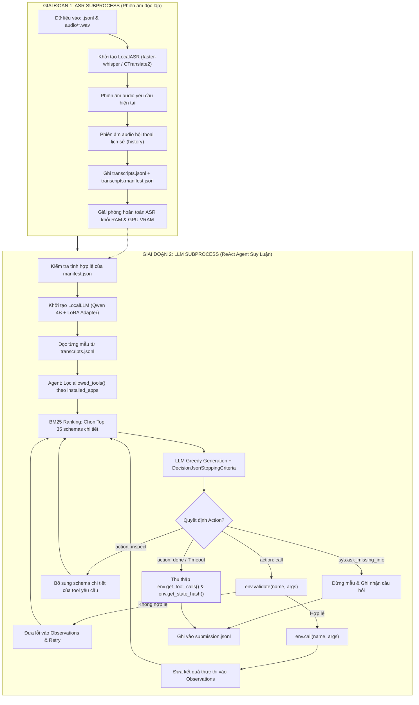

# Kiến Trúc Pipeline & Cấu Trúc Mã Nguồn — LifeMate (Voice-to-Tools Agent)

Tài liệu này tổng hợp toàn diện cấu trúc thư mục, chức năng từng module và chi tiết luồng xử lý (pipeline) của hệ thống **LifeMate Baseline** trong thư mục [`code/`](file:///AIClub_NAS/bachdx/ZaloAI/Track1/ZAC2026_LifeMate/code). Hệ sinh thái này được thiết kế theo chuẩn mã nguồn mô-đun hóa, hỗ trợ kiến trúc **Staged Pipeline (tách rời ASR và LLM để giải phóng VRAM)**, tối ưu huấn luyện với **Unsloth (LoRA/QLoRA)** và sẵn sàng đóng gói Docker chạy suy luận hoàn toàn ngoại tuyến (**fully offline**) cho cuộc thi Zalo AI Challenge.

---

## 1. Cấu Trúc Thư Mục Tổng Thể (Repository Layout)

```text
/AIClub_NAS/bachdx/ZaloAI/Track1/ZAC2026_LifeMate/code/
├── main.py                     # Entrypoint CLI: điều phối toàn bộ quá trình suy luận (Inference Orchestrator)
├── finetune.py                 # Pipeline trọn gói: chuẩn bị SFT -> huấn luyện LoRA -> lưu adapter
├── prepare_sft.py              # Tiền xử lý tập TRAIN: Replay gold tool calls qua ToolEnv tạo dữ liệu đối thoại
├── train_lora.py               # Huấn luyện SFT LoRA với Unsloth / HuggingFace & rollout evaluation
├── merge_lora.py               # Gộp LoRA adapter vào mô hình gốc thành checkpoint 16-bit độc lập
├── score_train.py              # Đánh giá proxy Tool-Call F1 độc lập trên tập TRAIN
├── run_server.sh               # Shell script cấu hình biến môi trường và chạy pipeline trên server
├── Dockerfile                  # Cấu hình container đóng gói phục vụ nộp bài offline
├── .dockerignore               # Các mẫu loại trừ khi build docker image
├── requirements.txt            # Danh sách thư viện Python (PyTorch, Unsloth, Transformers, CTranslate2)
├── README.md                   # Tài liệu hướng dẫn kỹ thuật và benchmark gốc
│
├── lifemate/                   # Gói xử lý lõi (Core Python Package)
│   ├── __init__.py             # Định danh Python package
│   ├── agent.py                # Vòng lặp Agent (ReAct: Observe -> Plan -> Validate -> Execute)
│   ├── catalog.py              # Quản lý Schema, lọc allowed_tools và xếp hạng BM25-like
│   ├── context.py              # Định nghĩa giới hạn Token Context (Prompt 16,000 + Output 384)
│   ├── decoding.py             # Early stopping decoder: dừng ngay khi đóng xong JSON action hợp lệ
│   ├── evaluation.py           # Rollout validation callback trong quá trình train
│   ├── gpu.py                  # Quản lý và cô lập GPU an toàn (--cuda-visible-devices)
│   ├── models.py               # Wrappers: LocalASR (CTranslate2) & LocalLLM (Transformers/PEFT)
│   ├── scoring.py              # Đánh giá độ khớp State Hash & Tool Call F1 theo tiêu chuẩn BTC
│   ├── sft.py                  # Logic Replay gold tool calls và xây dựng prompt SFT
│   └── transcripts.py          # Quản lý lưu trữ đệm ASR (transcripts.jsonl + manifest.json)
│
├── scripts/                    # Scripts tiện ích
│   └── download_models.py      # Tải trước trọng số ASR & LLM từ Hugging Face về máy cục bộ
│
├── tests/                      # Kiểm thử độc lập (Unit Tests)
│   ├── test_baseline.py        # Mock test luồng Agent, Schema validation và F1 scoring
│   └── test_staged_pipeline.py # Kiểm thử cơ chế tách rời stage ASR và stage LLM
│
├── logs/                       # Thư mục lưu nhật ký chẩn đoán (diagnostics.jsonl, finetune.log)
└── result/                     # Thư mục xuất file nộp bài (submission.jsonl, transcripts.jsonl)
```

### Chi tiết chức năng từng module

| Module / File | Vai trò | Điểm kỹ thuật cốt lõi |
| :--- | :--- | :--- |
| [`main.py`](file:///AIClub_NAS/bachdx/ZaloAI/Track1/ZAC2026_LifeMate/code/main.py) | **Điều phối chính (Orchestrator)** | Hỗ trợ 3 chế độ `--stage {full, asr, llm}`. Khởi tạo seed, cấu hình offline (`HF_HUB_OFFLINE=1`), giải quyết đường dẫn dữ liệu (`resolve_data_layout`) và xuất file `submission.jsonl`. |
| [`lifemate/transcripts.py`](file:///AIClub_NAS/bachdx/ZaloAI/Track1/ZAC2026_LifeMate/code/lifemate/transcripts.py) | **Quản lý Cache ASR** | Nhận diện dataset qua SHA256, kiểm tra tính toàn vẹn (audio stamps, model stamps), hỗ trợ resume khi chạy dở dang, đảm bảo ASR hoàn tất 100% trước khi bước LLM khởi chạy. |
| [`lifemate/agent.py`](file:///AIClub_NAS/bachdx/ZaloAI/Track1/ZAC2026_LifeMate/code/lifemate/agent.py) | **Agent Brain & ReAct Loop** | Xây dựng prompt tương thích hoàn toàn giữa SFT và Inference; cơ chế `fit_prompt_payload` chống tràn ngữ cảnh; kiểm soát lỗi 2 bước (`env.validate` -> `env.call`); cơ chế `inspect` schema. |
| [`lifemate/decoding.py`](file:///AIClub_NAS/bachdx/ZaloAI/Track1/ZAC2026_LifeMate/code/lifemate/decoding.py) | **Early Stopping Decoder** | `DecisionJsonStoppingCriteria`: dừng sinh từ ngay lập tức khi LLM vừa đóng xong dấu ngoặc nhọn `}` của object JSON cấp cao nhất (`call`, `done`, `inspect`), tiết kiệm tối đa thời gian suy luận. |
| [`lifemate/catalog.py`](file:///AIClub_NAS/bachdx/ZaloAI/Track1/ZAC2026_LifeMate/code/lifemate/catalog.py) | **Lọc & Xếp hạng Tools** | Lọc theo `context["installed_apps"]`, tính điểm trùng khớp từ khóa (BM25-style scoring) để chọn `max_tool_details` schemas chi tiết đưa vào prompt; thêm meta-tool `sys.ask_missing_info`. |
| [`lifemate/models.py`](file:///AIClub_NAS/bachdx/ZaloAI/Track1/ZAC2026_LifeMate/code/lifemate/models.py) | **Local Model Wrappers** | `LocalASR`: CTranslate2 engine, greedy decoding (`beam_size=1`, `temperature=0`).<br>`LocalLLM`: Nạp Qwen qua Transformers, hỗ trợ LoRA adapter qua PEFT, giải mã tham lam (`do_sample=False`). |
| [`lifemate/scoring.py`](file:///AIClub_NAS/bachdx/ZaloAI/Track1/ZAC2026_LifeMate/code/lifemate/scoring.py) | **Chấm điểm State-Gated Tool F1** | Hiện thực thuật toán chấm điểm của BTC: nếu có gold calls mà `state_hash` không khớp thì 0 điểm; tính Token-F1 (>0.6) cho các tham số fuzzy và so khớp 1-1 cực đại (Max Bipartite Matching). |
| [`finetune.py`](file:///AIClub_NAS/bachdx/ZaloAI/Track1/ZAC2026_LifeMate/code/finetune.py) | **Auto Fine-tuning Wrapper** | Kết hợp tự động `prepare_sft.py` -> `train_lora.py` -> xuất LoRA adapter trong 1 câu lệnh duy nhất. |
| [`prepare_sft.py`](file:///AIClub_NAS/bachdx/ZaloAI/Track1/ZAC2026_LifeMate/code/prepare_sft.py) | **Chuẩn bị dữ liệu SFT** | Chia train/val theo sample ID (chống rò rỉ); replay các lệnh gọi qua `ToolEnv` thực để lấy `observations` trung gian thực tế; tự động sinh bước `inspect` nếu tool nằm ngoài top-k. |
| [`train_lora.py`](file:///AIClub_NAS/bachdx/ZaloAI/Track1/ZAC2026_LifeMate/code/train_lora.py) | **Huấn luyện Unsloth LoRA** | Dùng `FastLanguageModel` tối ưu VRAM; chỉ tính loss trên token câu trả lời của Assistant; đánh giá checkpoint bằng rollouts thực tế (`eval_state_tool_score`) thay vì validation loss thông thường. |

---

## 2. Kiến Trúc Pipeline Hai Giai Đoạn (Two-Stage Architecture)

Để giải quyết triệt để vấn đề quá tải bộ nhớ GPU (VRAM OOM) khi vừa nạp mô hình ASR (Whisper Large/Turbo ~1.5GB - 3GB) vừa nạp LLM (Qwen 4B ~8GB - 9GB), hệ thống áp dụng cơ chế **Two-Stage Pipeline**:



---

## 3. Chi Tiết Các Bước Thực Thi Của Pipeline

### 3.1. Giai đoạn 1: Xử lý Âm thanh & Quản lý Cache (ASR Stage)
1. **Kiểm tra tính nhất quán (`dataset_identity` & `asr_identity`)**:
   - Tính mã băm SHA256 dựa trên kích thước file và thời gian sửa đổi (`mtime_ns`) của tất cả file audio và file dữ liệu nguồn.
   - Lưu trữ siêu dữ liệu phiên âm vào `transcripts.manifest.json` (model path, compute_type, beam_size, seed, version thư viện).
2. **Xử lý âm thanh nối tiếp**:
   - Nếu đã có file `.partial.jsonl` từ lần chạy trước bị gián đoạn, pipeline tự động nạp lại và tiếp tục xử lý các mẫu còn thiếu mà không chạy lại từ đầu.
   - Phiên âm âm thanh câu thoại chính: `item["audio"]`.
   - Phiên âm các lượt thoại lịch sử trong quá khứ (`turn["audio"]`) nếu chưa có text sẵn, giúp Agent nắm trọn vẹn ngữ cảnh hội thoại đa lượt.
3. **Giải phóng tài nguyên**: Tiến trình ASR kết thúc, giải phóng 100% tài nguyên GPU/CPU trước khi tiến trình LLM được khởi động.

---

### 3.2. Giai đoạn 2: Vòng Lặp Suy Luận ReAct Của Agent (LLM Stage)
Vòng lặp ReAct được thiết kế chặt chẽ trong `LifeMateAgent.run()`:

1. **Lọc và xếp hạng công cụ (Dynamic Schema Ranking)**:
   - `allowed_tools`: Loại bỏ ngay lập tức các công cụ thuộc ứng dụng mà người dùng chưa cài đặt trong `context["installed_apps"]`.
   - `rank_tools`: Dùng thuật toán BM25-like để chấm điểm độ tương đồng từ vựng giữa câu yêu cầu của người dùng (`search_query`) với tên công cụ, mô tả và tên tham số.
   - Ưu tiên công cụ đọc (`kind="read"`): Luôn đưa các công cụ đọc của app liên quan vào danh sách chi tiết để LLM có thể tra cứu thông tin (như thiết bị ID, danh bạ) trước khi thực hiện ghi (`kind="write"`).
2. **Bộ điều hòa kích thước Prompt (`fit_prompt_payload`)**:
   - Giới hạn ngữ cảnh: Mặc định tối đa 16,000 token đầu vào (`max_input_tokens = 16000`).
   - Nếu prompt quá dài, hàm sẽ lần lượt: (1) Cắt bớt schemas của các tool có điểm liên quan thấp nhất; (2) Thu gọn mô tả của tool index xuống 35 ký tự; (3) Rút gọn chuỗi kết quả observation trước đó. Đảm bảo cấu trúc JSON của prompt luôn hoàn chỉnh, không bao giờ bị cắt vụn cú pháp.
3. **Dừng sớm trong sinh mã (`DecisionJsonStoppingCriteria`)**:
   - Thay vì sinh tối đa 384 token và phải chờ sinh các lời giải thích thừa, cơ chế dừng sớm theo dõi luồng token của LLM và dừng ngay lập tức khi phát hiện dấu `}` kết thúc của JSON object quyết định (`call`, `done`, `inspect`). Giúp giảm 60-80% thời gian suy luận của LLM!
4. **Thực thi an toàn 2 bước**:
   - **Bước 1: Validate**: `env.validate(name, args)` kiểm tra kiểu dữ liệu và tham số bắt buộc. Nếu sai schema, trả lỗi về cho LLM sửa ở lượt sau mà **không làm thay đổi `state_hash`** và không bị phạt vào log gọi tool của BTC.
   - **Bước 2: Execute**: Chỉ khi validate thành công mới gọi `env.call(name, args)`.
5. **Cơ chế chống lặp & bảo vệ ngân sách**:
   - `recent_reads`: Chặn các lệnh `read` lặp lại với cùng tham số nếu trạng thái chưa hề thay đổi qua một lệnh `write`.
   - Ngân sách gọi: Tối đa `max_calls = 8` lần thực thi và `max_invalid = 3` lần đề xuất sai.
6. **Đóng gói kết quả**:
   - Lấy `tool_calls = env.get_tool_calls()` và `state_hash = env.get_state_hash()`.
   - Ghi lập tức vào `submission.jsonl` kèm flush buffer để chống mất dữ liệu khi crash.

---

### 3.3. Giai đoạn 3: Huấn Luyện Tinh Chỉnh Mô Hình (Fine-Tuning Pipeline)
Hệ sinh thái cung cấp quy trình huấn luyện khép kín bằng **Unsloth**:

1. **`prepare_sft.py`**:
   - Đọc nhãn `label.tool_calls` từ `train.jsonl`.
   - Chạy mô phỏng từng bước gọi qua `ToolEnv` thực tế để thu thập đúng định dạng kết quả trả về (`observations`).
   - Nếu công cụ đúng nằm ngoài top-k của bộ xếp hạng, tự động chèn một bước hành động `{"action": "inspect", "name": "app.tool"}` để dạy mô hình biết tự tra cứu schema khi cần.
   - Chia tập validation (10%) độc lập theo `sample_id` (không rò rỉ bước đối thoại).
2. **`train_lora.py`**:
   - Sử dụng Unsloth `FastLanguageModel` (hỗ trợ LoRA 16-bit unquantized hoặc 4-bit QLoRA).
   - Thiết lập `loss` chỉ tính trên các token của Assistant (masking toàn bộ prompt và context).
   - **Checkpoint Selection theo `eval_state_tool_score`**: Sau mỗi epoch, chạy Agent suy luận thực tế (rollout) trên tập held-out validation để tính điểm kết hợp giữa State Hash Match và Tool-Call F1. Checkpoint có điểm số rollout cao nhất sẽ được giữ lại (thay vì chọn theo validation loss).

---

## 4. Hướng Dẫn Vận Hành Thực Tế (Cheatsheet)

### 1. Chạy Suy Luận Trọn Gói (Inference Full Pipeline)
```bash
cd /AIClub_NAS/bachdx/ZaloAI/Track1/ZAC2026_LifeMate/code

# Chạy trên 1 GPU chỉ định (ví dụ GPU 2)
python main.py \
    --stage full \
    --cuda-visible-devices 2 \
    --data-root /AIClub_NAS/bachdx/ZaloAI/Track1/dataset/train+public_test \
    --split public_test \
    --asr-model ./models/asr \
    --llm-model ./models/llm \
    --output result/submission.jsonl
```

### 2. Chạy Tách Rời Từng Giai Đoạn (Two-Stage Decoupled)
```bash
# Bước 1: Chỉ chạy ASR và lưu cache transcripts
python main.py \
    --stage asr \
    --cuda-visible-devices 2 \
    --data-root /AIClub_NAS/bachdx/ZaloAI/Track1/dataset/train+public_test \
    --split public_test \
    --asr-model ./models/asr \
    --transcript-cache result/public_transcripts.jsonl

# Bước 2: Chỉ chạy LLM từ cache đã tạo (hoàn toàn không nạp ASR)
python main.py \
    --stage llm \
    --cuda-visible-devices 2 \
    --data-root /AIClub_NAS/bachdx/ZaloAI/Track1/dataset/train+public_test \
    --split public_test \
    --transcript-cache result/public_transcripts.jsonl \
    --llm-model ./models/llm \
    --output result/submission.jsonl
```

### 3. Huấn Luyện LoRA Tinh Chỉnh Cho LLM (Fine-Tuning)
```bash
python finetune.py \
    --cuda-visible-devices 2 \
    --data-root /AIClub_NAS/bachdx/ZaloAI/Track1/dataset/train+public_test \
    --base-model ./models/llm \
    --asr-model ./models/asr \
    --output-dir result/finetune_run1 \
    --epochs 3 \
    --batch-size 1 \
    --gradient-accumulation 8 \
    --learning-rate 2e-4
```
Sau khi huấn luyện xong, truyền adapter vào để suy luận:
```bash
python main.py \
    --stage full \
    --cuda-visible-devices 2 \
    --data-root /AIClub_NAS/bachdx/ZaloAI/Track1/dataset/train+public_test \
    --split public_test \
    --asr-model ./models/asr \
    --llm-model ./models/llm \
    --llm-adapter result/finetune_run1/training/adapter \
    --output result/submission_finetuned.jsonl
```
