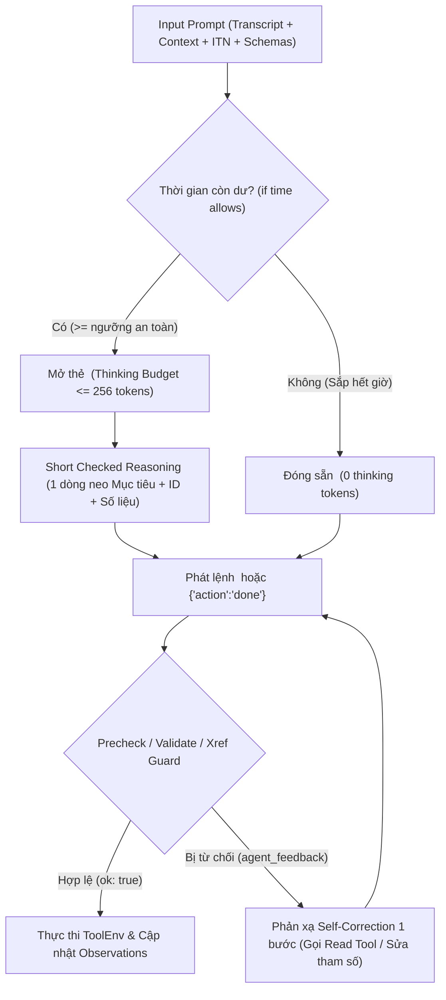

# Báo Cáo Đề Xuất Cải Tiến LifeMate Pipeline: Self-Correction, Short Checked Reasoning & Adaptive Thinking Budget

Báo cáo này tổng hợp phân tích kỹ thuật, đánh giá tác động điểm số thực nghiệm và thiết kế triển khai chi tiết cho 3 hạng mục nâng cấp trên codebase [`lifemate`](file:///mnt/mmlab2024nas/trantran/lifemate/code/lifemate):

1. **Quỹ đạo Tự sửa lỗi (Self-Correction / `agent_feedback` SFT Trajectories)**
2. **Suy luận ngắn có kiểm chứng bằng code (Short Checked Reasoning)**
3. **Ngân sách suy luận 256 token thích ứng thời gian (256 Thinking Budget, if time allows)**

---

## 1. Bức Tranh Thực Nghiệm Hiện Tại & Ma Trận Ưu Tiên

Dựa trên dữ liệu chẩn đoán từ các lần chạy thực tế trong [`code/result`](file:///mnt/mmlab2024nas/trantran/lifemate/code/result) (tập Validation 154 mẫu tại [`eval_results.json`](file:///mnt/mmlab2024nas/trantran/lifemate/code/result/finetune_20261104_183041/training/eval_results.json) và tập `public_test` 634 mẫu tại [`submission.diagnostics.jsonl`](file:///mnt/mmlab2024nas/trantran/lifemate/code/result/finetune_20261104_183041/inference/submission.diagnostics.jsonl)):

| Nhóm lỗi / Hiện tượng | Số lượng trên Validation (154 mẫu) | Số lượng trên Public Test (634 mẫu) | Hạng mục giải quyết trực tiếp | Kỳ vọng tăng điểm |
| :--- | :--- | :--- | :--- | :--- |
| **Thiếu bước gọi hàm (`missing_calls`)** | 66 mẫu (105 calls) | Phổ biến ở câu đa ý | **Short Checked Reasoning** + **256 Thinking Budget** | **Cao (+2.0% – +4.0%)** |
| **Gọi sai tham số (`wrong_arguments`)** | 42 mẫu (49 calls) | Phổ biến ở số tiền/ID/ngày | **Short Checked Reasoning** (neo số liệu/ID) | **Cao** (gộp chung ở trên) |
| **Dừng sớm (`early_stop`)** | 29 mẫu | Phổ biến ở câu 2–3 vế | **Short Checked Reasoning** (đếm tiến độ `1/2`, `2/2`) | **Trung bình – Cao** |
| **Bị chặn bởi Guard (`invalid_proposals > 0`)** | 0 mẫu chạm `max_invalid` (Epoch 2–3) | 4–10 mẫu (`0.6% – 1.5%`), 0–5 mẫu chạm `max_invalid` | **Self-Correction (`agent_feedback` SFT)** | **Phòng thủ (+0.3% – +0.8%)** |



---

## 2. Ý Tưởng 1: Quỹ Đạo Tự Sửa Lỗi (Self-Correction / `agent_feedback` SFT)

### 2.1. Vấn đề trong code hiện tại
- Trong [`specialist_training.py`](file:///mnt/mmlab2024nas/trantran/lifemate/code/lifemate/specialist_training.py#L116-L122), nhánh sinh `local_schema.inspect` kiểm tra `observation.get("stage") in ("validate", "precheck")` và `"result" not in observation`.
- Tuy nhiên, [`replay_sample`](file:///mnt/mmlab2024nas/trantran/lifemate/code/lifemate/sft.py#L286-L309) chỉ chạy lại chuỗi `label.tool_calls` chuẩn (vượt qua `validate` 100%). Do đó nhánh này là **dead code** lúc chuẩn bị dữ liệu (0 mẫu được sinh ra trong [`manifest.json`](file:///mnt/mmlab2024nas/trantran/lifemate/code/result/run_sft_dual/sft/manifest.json)).
- Module [`recovery.py`](file:///mnt/mmlab2024nas/trantran/lifemate/code/lifemate/recovery.py#L112-L261) hiện mới chỉ giả lập kịch bản **tìm kiếm trả về danh sách rỗng** (`executed=True`, có `"result": "[]"`), chưa có kịch bản phục hồi khi lệnh gọi bị từ chối thực thi (`executed=False`, sinh `{"agent_feedback": ...}`).

### 2.2. Ba rào cản kiến trúc cần tuân thủ khi triển khai
1. **Cách render `agent_feedback` không có lượt `assistant` lỗi:**
   Trong [`native_observation_messages`](file:///mnt/mmlab2024nas/trantran/lifemate/code/lifemate/function_calling.py#L73-L75), một `observation` bị từ chối (`"result" not in observation`) được chuyển thành một message `role="user"` duy nhất: `{"agent_feedback": observation}`, **không có** message `assistant` đứng trước. Vì vậy, **không được** chèn lượt `assistant` giả lập lỗi rồi mask `labels = -100` vào lịch sử hội thoại (sẽ gây lệch cấu trúc prompt so với lúc chạy [`LifeMateAgent._run`](file:///mnt/mmlab2024nas/trantran/lifemate/code/lifemate/agent.py#L251-L260)).
2. **Cơ chế xóa `agent_feedback` sau khi sửa lỗi thành công:**
   Trong [`agent.py`](file:///mnt/mmlab2024nas/trantran/lifemate/code/lifemate/agent.py#L286-L301), ngay khi bước kế tiếp thực thi thành công, câu lệnh `observations[:] = [o for o in observations if 'result' in o]` sẽ xóa bỏ mọi `agent_feedback` trước đó. Do đó, không thể gộp bước lỗi này vào [`collapse_trajectory`](file:///mnt/mmlab2024nas/trantran/lifemate/code/lifemate/sft.py#L315-L338) (vốn chỉ lấy `steps[-1]` để dựng cả hội thoại và kiểm tra `len(spans) == len(trained)` trong [`_encode_native_with_spans`](file:///mnt/mmlab2024nas/trantran/lifemate/code/lifemate/sft.py#L382-L385)).
3. **Lỗi phổ biến nhất là `xref_guard` (Write-before-Read), và nên sửa trực tiếp thay vì gọi `local_schema.inspect`:**
   - Khi mô hình truyền tên người (`"Cô Ly"`) vào `contact_id`, `env.validate` vẫn báo hợp lệ kiểu `string`, nhưng [`check_observed_xref`](file:///mnt/mmlab2024nas/trantran/lifemate/code/lifemate/tool_execution.py#L58-L62) sẽ chặn ở `stage="xref_guard"`.
   - Nếu gọi `local_schema.inspect`, hàm [`inspect_call`](file:///mnt/mmlab2024nas/trantran/lifemate/code/lifemate/local_checks.py#L229-L244) vẫn trả về `valid` (vì chỉ kiểm tra schema tĩnh) và tốn thêm 1 lượt LLM. Phản xạ tối ưu là **đọc `agent_feedback` -> gọi ngay hàm `read`/`search` còn thiếu (hoặc phát lại lệnh đúng)**.

### 2.3. Cách triển khai vào Repo hiện tại
- **File cần sửa/thêm:** [`code/lifemate/recovery.py`](file:///mnt/mmlab2024nas/trantran/lifemate/code/lifemate/recovery.py) và [`code/prepare_sft.py`](file:///mnt/mmlab2024nas/trantran/lifemate/code/prepare_sft.py).
- **Thiết kế hàm `build_guard_recovery_examples(record, prepared_transcript, steps, catalog, env_factory)` trong [`recovery.py`](file:///mnt/mmlab2024nas/trantran/lifemate/code/lifemate/recovery.py):**
  1. Tìm các mẫu có cấu trúc chuẩn: `Bước k` là lệnh `read`/`search` (ví dụ `contacts.search`, `maps.search_place`, `smart_home.get_status`) và `Bước k+1` là lệnh `write` sử dụng ID `x-ref` lấy từ kết quả của `Bước k`.
  2. Trên một tỷ lệ nhỏ mẫu (15%–20%, chọn tất định theo hash của `sample_id`), tại thời điểm ngay trước `Bước k` (khi `observed_ids` chưa có ID đích):
     - Giả lập đề xuất lỗi: gọi sớm lệnh `write` của `Bước k+1` nhưng thay giá trị tham số `x-ref` bằng tên thực thể/từ khóa tìm kiếm của `Bước k` (hoặc bỏ thiếu 1 tham số `required`).
     - Chạy qua [`attempt_env_call`](file:///mnt/mmlab2024nas/trantran/lifemate/code/lifemate/tool_execution.py#L86-L141) với `observed_ids` hiện tại để lấy đúng object `outcome["feedback"]` thật từ môi trường.
  3. Đưa `outcome["feedback"]` vào `observations_with_error = observations_before_step_k + [outcome["feedback"]]`.
  4. Tạo **1 dòng SFT đơn bước (`full_trajectory=False`)** với prompt chứa `observations_with_error` và target `assistant` chính là lệnh gọi `Bước k` (gọi hàm `read`/`search` đúng, hoặc gọi lệnh `write` đã điền đủ tham số `required`).
  5. Trong [`prepare_sft.py`](file:///mnt/mmlab2024nas/trantran/lifemate/code/prepare_sft.py#L284-L290), ghi bổ sung dòng `full_trajectory=False` này ra `train.jsonl` bên cạnh dòng `full_trajectory=True` gốc. Hàm [`encode_example`](file:///mnt/mmlab2024nas/trantran/lifemate/code/lifemate/sft.py#L415-L436) đã hỗ trợ sẵn việc encode dòng `full_trajectory=False` song song với `full_trajectory=True`.

---

## 3. Ý Tưởng 2: Suy Luận Ngắn Có Kiểm Chứng (Short Checked Reasoning)

> *"Short checked reasoning: a large model writes one line of reasoning before each action, numbers checked by code."*

### 3.1. Hiện trạng trong Repo
- **Phần *"numbers checked by code"* ĐÃ CÓ:** Pipeline đã tính sẵn `user_context.date_reference` ([`prompt_session.py`](file:///mnt/mmlab2024nas/trantran/lifemate/code/lifemate/prompt_session.py#L33-L41)), `itn_candidates` ([`itn.py`](file:///mnt/mmlab2024nas/trantran/lifemate/code/lifemate/itn.py)), và các công cụ Python [`local_assist.solve`](file:///mnt/mmlab2024nas/trantran/lifemate/code/lifemate/local_assist.py), [`local_checks.evaluate`](file:///mnt/mmlab2024nas/trantran/lifemate/code/lifemate/local_checks.py), cùng bộ kiểm tra [`arguments_ready`](file:///mnt/mmlab2024nas/trantran/lifemate/code/lifemate/batching.py#L124-L173).
- **Phần *"one line of reasoning before each action"* ĐANG TẮT:** [`configure_tokenizer`](file:///mnt/mmlab2024nas/trantran/lifemate/code/lifemate/llm.py#L33) đang đặt `{"enable_thinking": False}` và [`tool_call_message`](file:///mnt/mmlab2024nas/trantran/lifemate/code/lifemate/function_calling.py#L52-L55) đang để trống `reasoning_content=""` và `content=""`. Tuy nhiên, [`visible_output`](file:///mnt/mmlab2024nas/trantran/lifemate/code/lifemate/function_calling.py#L142-L150) và [`NativeToolStoppingCriteria`](file:///mnt/mmlab2024nas/trantran/lifemate/code/lifemate/decoding.py#L171-L191) đã hỗ trợ sẵn việc bỏ qua thẻ `<think>...</think>` khi parse lệnh gọi hàm.

### 3.2. Nội dung & Khuôn mẫu dòng suy luận (1-Line Grounding)
Trước mỗi hành động, mô hình viết **đúng 1 dòng suy luận ngắn (15–45 token)** bên trong thẻ `<think>...</think>` theo cấu trúc 3 neo:
1. **Tiến độ mục tiêu (Sub-goal Tracking):** Đang ở bước mấy trên tổng số yêu cầu của người dùng (trị dứt điểm lỗi `missing_calls` và `early_stop`).
2. **Nguồn thực thể / ID (Entity Provenance):** Lấy ID nào từ kết quả `read` hoặc `history` nào.
3. **Nguồn số học / thời gian (Checked Numerics):** Lấy số tiền, số lượng, ngày giờ từ `itn_candidates`, `date_reference` hay `local_assist.solve`.

**Ví dụ minh họa:**
- *Trước bước Read:*
  ```xml
  <think>
  Bước 1/2: Cần tìm contact_id của "Cô Ly" trước khi chuyển 350000 (từ itn_candidates "ba trăm rưỡi") -> gọi contacts.search.
  </think>
  ```
- *Trước bước Write:*
  ```xml
  <think>
  Bước 2/2: Đã có recipient_id="ct_04" (Cô Ly) từ contacts.search, amount=350000 từ itn_candidates -> gọi ewallet.transfer.
  </think>
  ```
- *Trước bước Done:*
  ```xml
  <think>
  Đã hoàn tất đủ 2/2 yêu cầu (contacts.search, ewallet.transfer) -> kết thúc.
  </think>
  ```

### 3.3. So sánh Phương Án Tạo Dữ Liệu Reasoning: Python Tất Định vs. LLM (Trên Ngân Sách 22 GB VRAM)

Với ngân sách phần cứng mục tiêu là **~22 GB VRAM** (tương đương L4 / RTX 4090 / RTX PRO 4000 dành riêng):

| Tiêu chí | Phương án 1: Python Tất Định (`reasoning.py`) — **Khuyên dùng** | Phương án 2: Dùng LLM (Teacher 7B–14B trên 22GB VRAM) |
| :--- | :--- | :--- |
| **Chất lượng học của Qwen3.5-4B (LoRA `r=16`)** | **Tốt nhất:** Khuôn mẫu câu cố định 100% (`"Bước k/N: [nguồn ID/số liệu] -> gọi [tool]"`). LoRA học thuộc cấu trúc neo dữ liệu cực nhanh sau 2 epoch, không tốn dung lượng adapter cho từ vựng hoa mỹ. | **Kém ổn định hơn:** Cách diễn đạt biến thiên giữa các mẫu làm tăng entropy của token suy luận, khiến model 4B dễ sinh câu dài dòng lúc inference. |
| **Độ chính xác Số học / ID / Ngày tháng** | **Đạt 100% tuyệt đối ngay từ đầu:** Trích xuất trực tiếp từ `date_reference`, `itn_candidates`, `observations[:k]` và `target_call`. Không bao giờ tính nhẩm sai hay lộ thông tin bước tương lai. | Dễ bị ảo giác số học hoặc lộ ID của bước $k+1$ (vẫn bắt buộc phải viết code Python `verify_reasoning_line` để lọc và fallback). |
| **Chi phí tạo dữ liệu SFT (10.129 lượt)** | **~2 – 3 giây trên CPU**, tốn **0 MB VRAM**. | Mất **2 – 3,5 giờ chạy GPU** (nạp model 7B bf16 ~15GB hoặc 14B 4-bit ~10GB VRAM để prefill 10.129 lượt). |
| **Xử lý câu điều kiện ("Nếu... thì...")** | Có thể kết hợp hàm [`requires_observation`](file:///mnt/mmlab2024nas/trantran/lifemate/code/lifemate/batching.py#L114-L121) để trích xuất kết quả kiểm tra điều kiện từ `observations` trước khi kết luận nhánh rẽ. | Diễn giải câu điều kiện tự nhiên hơn nhưng dễ vượt quá 50 tokens. |

> [!TIP]
> **Chiến lược tối ưu nhất (Deterministic Structured Python):** Dùng **Python tất định 100%** để sinh dòng *Short Checked Reasoning* dựa trên 4 nguồn dữ liệu có sẵn trong từng bước của [`replay_sample`](file:///mnt/mmlab2024nas/trantran/lifemate/code/lifemate/sft.py#L205-L312):
> 1. **Tiến độ bước (`Bước k/N`):** Đếm số lệnh gọi ứng dụng trong chuỗi hành động.
> 2. **Neo ID (`x-ref`):** Đối chiếu giá trị tham số `x-ref` của bước hiện tại với kết quả `result` của các lệnh `read`/`search` ở bước trước để ghi rõ tên thực thể + ID (ví dụ: `recipient_id="ct_04" ("Cô Ly") từ contacts.search`).
> 3. **Neo Ngày/Giờ:** Đối chiếu tham số ngày/giờ với `user_context.date_reference` hoặc kết quả `local_assist.solve`.
> 4. **Neo Số tiền/SĐT/Email:** Đối chiếu với `itn_candidates` (ví dụ: `amount=350000 từ itn_candidates ("ba trăm rưỡi")`).

---

## 4. Ý Tưởng 3: Ngân Sách Suy Luận Nhỏ Thích Ứng Thời Gian (256 Thinking Budget, If Time Allows)

> *"A small thinking budget: 256 thinking tokens per turn, if time allows."*

### 4.1. Sự cộng hưởng với Short Checked Reasoning & KV Prefix Cache
1. **Bảo vệ ngân sách `<tool_call>`:** Trần cứng `256` token cho phần `<think>` đảm bảo mô hình không bao giờ suy nghĩ quá đà làm lẹm vào phần token dành cho `<tool_call>...</tool_call>`.
2. **Chuyển đổi 0-overhead khi hết giờ (*"if time allows"*):**
   Nhờ cấu trúc [`qwen35_chat_template.jinja`](file:///mnt/mmlab2024nas/trantran/lifemate/code/tests/fixtures/qwen35_chat_template.jinja#L150-L156):
   - Khi còn thời gian (`enable_thinking=True`): Prompt kết thúc bằng `<|im_start|>assistant\n<think>\n`, cho phép mô hình viết dòng suy luận (tối đa 256 token).
   - Khi sắp hết thời gian (`enable_thinking=False`): Prompt kết thúc bằng `<|im_start|>assistant\n<think>\n\n</think>\n\n`, ép mô hình bỏ qua suy luận và sinh thẳng `<tool_call>` ngay ở token đầu tiên.
3. **Bảo toàn 100% tốc độ KV Prefix Cache (`Ephemeral Thinking`):**
   - Ở bước $t$, hàm [`visible_output`](file:///mnt/mmlab2024nas/trantran/lifemate/code/lifemate/function_calling.py#L142-L150) tự động tách bỏ phần `<think>...</think>` trước khi lưu lệnh gọi vào `observations`.
   - Sang bước $t+1$, các bước cũ trong `observations` được render với `reasoning_content=""` (và bản thân template Qwen3.5 ở dòng 103–107 cũng tự động lược bỏ `<think>` của các lượt trước `last_query_index`).
   - Nhờ đó, các token `<think>` ở bước $t$ **không làm phình ngữ cảnh bước $t+1$** và **không làm mất hiệu lực [`committed_prefix_ids`](file:///mnt/mmlab2024nas/trantran/lifemate/code/lifemate/prefix_cache.py#L62-L93)** của GPU Prefix Cache!

### 4.2. Bài Toán Đánh Đổi Ngân Sách `MAX_CONTEXT_TOKENS = 16.384` (Input vs. Output Budget)

Trong [`code/lifemate/context.py`](file:///mnt/mmlab2024nas/trantran/lifemate/code/lifemate/context.py#L2-L14), tổng độ dài ngữ cảnh bị khóa cứng bởi hằng số:
```python
MAX_CONTEXT_TOKENS = 16384
DEFAULT_MAX_NEW_TOKENS = 384
DEFAULT_MAX_INPUT_TOKENS = MAX_CONTEXT_TOKENS - DEFAULT_MAX_NEW_TOKENS  # 16000
```
Và hàm [`validate_inference_budget`](file:///mnt/mmlab2024nas/trantran/lifemate/code/lifemate/context.py#L7-L14) bắt buộc `max_input_tokens + max_new_tokens <= 16384`. Do đó, **mỗi token cấp thêm cho `max_new_tokens` (để chứa thẻ `<think>`) phải bớt tương ứng ở `max_input_tokens`**.

#### Số liệu đo đếm thực tế trên toàn bộ 3.078 trajectories (10.129 bước) của tập `train.jsonl`:
- **Độ dài Prompt đầu vào (`prompt_lengths`):**
  - Trung vị (`p50`): **9.329 tokens**
  - Phân vị 99% (`p99`): **13.063 tokens**
  - Cực đại (`max`): **14.213 tokens** (còn cách trần `16.384` tới **2.171 tokens**).
- **Độ dài một khối lệnh `<tool_call>...</tool_call><|im_end|>` (`call_token_lens`):**
  - Trung vị (`p50`): **43 tokens**
  - Phân vị 99% (`p99`): **108 tokens**
  - Cực đại (`max`): **168 tokens** (ngay cả ở các lệnh `local_batch.run` và `local_assist.solve` dài nhất).

Từ số liệu thực tế này, có **2 cấu hình phân bổ ngân sách `16.384`** (kết hợp cơ chế tự động co giãn):

| Cấu hình | `max_input_tokens` | `max_new_tokens` | Phân bổ bên trong `max_new_tokens` | Đánh giá & Khả năng tương thích |
| :--- | :--- | :--- | :--- | :--- |
| **Cấu hình A (Đúng 256 Thinking Budget)** | **`15.872`** (giảm 128 tokens) | **`512`** (tăng 128 tokens) | `256` thinking tokens + `256` tool call tokens | **An toàn tuyệt đối cho Input:** Prompt dài nhất thực tế là `14.213` tokens, vẫn còn dư **1.659 tokens** dưới ngưỡng `15.872`. Cần lưu ý cập nhật cờ `--max-input-tokens 15872 --max-new-tokens 512` nếu truyền thủ công qua CLI. |
| **Cấu hình B (Giữ nguyên CLI `16.000 / 384`)** | **`16.000`** (giữ nguyên) | **`384`** (giữ nguyên) | `192` thinking tokens + `192` tool call tokens | **Tương thích ngược 100% với mọi script/CLI cũ:** Vì `<tool_call>` dài nhất thực tế chỉ tốn `168` tokens (`< 192`), trần `192` thinking tokens vẫn dư sức chứa dòng *Short Checked Reasoning* (~25–40 tokens) mà không phải bớt `max_input_tokens`. |

> [!IMPORTANT]
> **Cơ chế Bảo hiểm Kép (Time & Context-Aware Adaptive Thinking Budget):**
> Thay vì giảm cứng khả năng chịu tải của Input ở những mẫu cực dài, ta kiểm tra động cả **thời gian còn lại** lẫn **số token đầu vào thực tế (`len(token_ids)`)** ngay trước mỗi bước `generate()`:
> - Chỉ bật `<think>` (với trần `thinking_budget = 256`) khi **đồng thời** thỏa mãn 2 điều kiện:
>   1. **Thời gian cho phép (*if time allows*):** `remaining_seconds >= reserve_seconds + thinking_reserve_seconds`
>   2. **Ngữ cảnh đầu vào còn chỗ (*if context allows*):** `len(token_ids) + thinking_budget + 256 <= MAX_CONTEXT_TOKENS` (tức `len(token_ids) <= 15.872`).
> - Nếu một mẫu hiếm gặp ở các bước cuối có `len(token_ids)` vượt quá `15.872` (nằm trong khoảng `15.873 .. 16.000`), hệ thống **tự động tắt `<think>` (`thinking_budget = 0`)** ở bước đó để nhường toàn bộ `384` tokens đầu ra cho `<tool_call>`, giúp mẫu đó vẫn chạy tiếp được đến `16.000` input tokens mà không bị lỗi `max_input_tokens`!

---

### 4.3. Phân tích Chi phí VRAM & Thời Gian (Latency) trên Phần Cứng 22 GB VRAM

| Giai đoạn | Mức tiêu thụ VRAM hiện tại | Mức tiêu thụ VRAM sau khi thêm 3 cải tiến | Đánh giá trên ngân sách **22 GB VRAM** |
| :--- | :--- | :--- | :--- |
| **Train LoRA (`train_lora.py`)** (`Qwen3.5-4B` bf16, `batch_size=1`, `max_length=16384`) | **~13,0 GB VRAM** | **~13,4 – 13,8 GB VRAM** (mỗi trajectory dài thêm ~80–120 tokens; tổng `full_lengths` cực đại mới chỉ ~14.340 / 16.384 tokens) | **An toàn tuyệt đối** (còn dư > 8 GB VRAM đệm). |
| **Inference (`main.py`)** (`Qwen3.5-4B` bf16 + `PrefixCache` + `SchemaCache`) | **~11,5 – 12,5 GB VRAM** (Weights: ~8,2 GB + Cache & Activations: ~3,5–4,3 GB) | **~11,6 – 12,8 GB VRAM** (KV Cache giữa các bước tăng **0 MB** do `<think>` được lược bỏ khỏi `observations` sau mỗi bước) | **Dư dả (~9 GB VRAM trống)**. Có thể tận dụng phần VRAM dư này để tăng `--schema-cache-mb` từ `256` lên **`1024` MiB** nhằm tăng tỷ lệ cache hit giữa các mẫu! |

**Về chi phí thời gian (Inference Latency trên 634 mẫu `public_test`, ~2.030 bước LLM):**
- Tốc độ sinh token của `Qwen3.5-4B` (`bfloat16`) đạt **~45 – 55 tokens/giây**.
- Ở các bước thông thường, mô hình viết 1 dòng *Short Checked Reasoning* dài **~25 tokens** rồi tự đóng `</think>` -> chỉ tốn thêm **~0,5 giây/bước** (~1,5 giây/mẫu).
- Trần `256` thinking tokens chỉ đóng vai trò **cầu chì bảo hiểm**: nếu gặp câu cực khó khiến mô hình suy nghĩ dài, nó sẽ bị ngắt ở đúng 256 tokens (~5 giây) để bắt buộc xuất `<tool_call>`; và nếu mẫu đó gần chạm giới hạn `sample_seconds` hoặc `max_input_tokens`, cờ *"if time & context allow"* sẽ tắt `<think>` về **0 giây / 0 token**.

---

## 5. Kế Hoạch Triển Khai Chi Tiết Từng File Trong Repo

Dưới đây là bản thiết kế thay đổi cụ thể trên từng module của [`code/lifemate`](file:///mnt/mmlab2024nas/trantran/lifemate/code/lifemate):

### Bước 1: Thêm `ThinkingBudgetLogitsProcessor` vào [`code/lifemate/decoding.py`](file:///mnt/mmlab2024nas/trantran/lifemate/code/lifemate/decoding.py)
Thêm một `LogitsProcessor` theo dõi quá trình sinh bên trong thẻ `<think>`:
```python
from transformers import LogitsProcessor

class ThinkingBudgetLogitsProcessor(LogitsProcessor):
    """Cap thinking tokens inside <think>...</think> at `max_thinking_tokens` (e.g., 256).
    If the model has not emitted `</think>` when reaching the budget, force `\n</think>\n\n`.
    """
    def __init__(self, tokenizer, prompt_length: int, max_thinking_tokens: int = 256):
        self.tokenizer = tokenizer
        self.prompt_length = prompt_length
        self.max_thinking_tokens = max_thinking_tokens
        self.close_seq = tokenizer.encode("\n</think>\n\n", add_special_tokens=False)
        self.end_think_id = tokenizer.convert_tokens_to_ids("</think>")
        self.forcing_idx = None

    def __call__(self, input_ids, scores):
        gen_ids = input_ids[0, self.prompt_length:].tolist()
        if self.forcing_idx is None:
            if self.end_think_id in gen_ids:
                return scores  # Model already closed </think> naturally
            if len(gen_ids) < self.max_thinking_tokens:
                return scores
            self.forcing_idx = 0
        if self.forcing_idx < len(self.close_seq):
            target_id = self.close_seq[self.forcing_idx]
            self.forcing_idx += 1
            scores[:] = float("-inf")
            scores[0, target_id] = 0.0
        return scores
```

### Bước 2: Hỗ trợ `reasoning` trong [`code/lifemate/function_calling.py`](file:///mnt/mmlab2024nas/trantran/lifemate/code/lifemate/function_calling.py) và [`code/lifemate/sft.py`](file:///mnt/mmlab2024nas/trantran/lifemate/code/lifemate/sft.py)
1. Trong [`function_calling.py`](file:///mnt/mmlab2024nas/trantran/lifemate/code/lifemate/function_calling.py#L52-L55):
   - Sửa `tool_call_message(name, arguments, content="", reasoning_content="")` để nhận `reasoning_content=target.get("reasoning", "")` ở lượt mục tiêu.
   - Với `target["action"] == "done"`, truyền `"reasoning_content": target.get("reasoning", "")`.
2. Trong [`sft.py`](file:///mnt/mmlab2024nas/trantran/lifemate/code/lifemate/sft.py#L36):
   - Cập nhật regex `_ASSISTANT_SPAN` và hàm [`_encode_native_with_spans`](file:///mnt/mmlab2024nas/trantran/lifemate/code/lifemate/sft.py#L362-L412):
     - Cho phép bắt toàn bộ span từ sau `<|im_start|>assistant\n<think>\n` (khi có `reasoning`) hoặc sau `<|im_start|>assistant\n<think>\n\n</think>\n\n` (khi không có `reasoning`).
     - Đặt trọng số loss `reasoning_weight = 0.25` cho các token nằm trước `</think>` để mô hình ưu tiên độ chính xác tuyệt đối của `<tool_call>` (trọng số `1.0`).
   - Lưu ý quan trọng: Đối với các lượt $1 \dots K-1$ trong Full-Trajectory SFT, vì template Qwen3.5 chỉ hiển thị `<think>...</think>` cho các lượt `assistant` nằm sau `last_query_index`, đối với những bước nằm trước một message `user` (`automatic_execution_feedback`), ta huấn luyện phần `<tool_call>` như hiện tại; hoặc sinh thêm các dòng step-wise cho những bước có `reasoning` để mọi bước đều được học `<think>{reasoning}</think>`.

### Bước 3: Điều khiển *"if time & context allow"* trong [`code/lifemate/context.py`](file:///mnt/mmlab2024nas/trantran/lifemate/code/lifemate/context.py), [`code/lifemate/agent.py`](file:///mnt/mmlab2024nas/trantran/lifemate/code/lifemate/agent.py) và [`code/lifemate/models.py`](file:///mnt/mmlab2024nas/trantran/lifemate/code/lifemate/models.py)
1. Trong [`context.py`](file:///mnt/mmlab2024nas/trantran/lifemate/code/lifemate/context.py#L2-L14):
   - Giữ `MAX_CONTEXT_TOKENS = 16384`.
   - Có thể giữ nguyên `DEFAULT_MAX_INPUT_TOKENS = 16000` và `DEFAULT_MAX_NEW_TOKENS = 384` để tương thích 100% với các script gọi CLI hiện tại (`--max-input-tokens 16000 --max-new-tokens 384` trong [`instruction.md`](file:///mnt/mmlab2024nas/trantran/lifemate/instruction.md#L370)), đồng thời dành riêng hằng số `MIN_TOOL_CALL_TOKENS = 192` (lớn hơn độ dài `<tool_call>` cực đại thực tế là `168` tokens).
2. Trong [`LocalLLM.generate`](file:///mnt/mmlab2024nas/trantran/lifemate/code/lifemate/models.py#L114-L186):
   - Sau khi tokenize xong `token_ids`, kiểm tra ngân sách token còn lại trong trần `MAX_CONTEXT_TOKENS = 16384`:
     ```python
     # Bảo đảm luôn chừa tối thiểu MIN_TOOL_CALL_TOKENS (192) cho phần <tool_call>
     room_for_generation = min(self.max_new_tokens, MAX_CONTEXT_TOKENS - len(token_ids))
     effective_thinking_budget = min(
         requested_thinking_budget,
         max(0, room_for_generation - MIN_TOOL_CALL_TOKENS),
     )
     ```
   - Nếu `requested_thinking_budget = 256`:
     - Khi `len(token_ids) <= 15936` (chiếm >99,9% trường hợp, vì max thực tế là `14.213` tokens) và cấu hình `max_new_tokens = 448` hoặc `512` (tương ứng `max_input_tokens = 15936` hoặc `15872`): mô hình được cấp đủ `effective_thinking_budget = 256` tokens.
     - Nếu giữ nguyên CLI `max_input_tokens = 16000, max_new_tokens = 384`: `effective_thinking_budget` tự động co về `384 - 192 = 192` tokens (vẫn gấp 6 lần độ dài ~30 tokens của dòng *Short Checked Reasoning*).
     - Nếu gặp mẫu có prompt quá dài tiến sát `16.000` tokens: `effective_thinking_budget` tự động hạ về `0` (tắt `<think>`) để bảo toàn toàn bộ token cho `<tool_call>` và không bao giờ vi phạm trần `16.384`.
3. Trong vòng lặp [`LifeMateAgent._run`](file:///mnt/mmlab2024nas/trantran/lifemate/code/lifemate/agent.py#L311-L323):
   ```python
   elapsed = time.monotonic() - t0
   remaining = self.cfg.sample_seconds - elapsed
   allow_thinking = (
       self.cfg.thinking_budget > 0
       and remaining >= (self.cfg.reserve_seconds + self.cfg.thinking_reserve_seconds)
   )
   raw = self.llm.generate(
       SYSTEM_PROMPT, user_prompt,
       thinking_budget=(self.cfg.thinking_budget if allow_thinking else 0),
   )
   ```

### Bước 4: Bổ sung Module Tạo Reasoning & Self-Correction vào [`code/prepare_sft.py`](file:///mnt/mmlab2024nas/trantran/lifemate/code/prepare_sft.py)
- Tạo module mới `code/lifemate/reasoning.py` chứa:
  1. `synthesize_checked_reasoning(transcript, context, history, observations, target_call, step_idx, total_steps)`: Tạo dòng suy luận 1 câu từ các toán hạng đã quan sát.
  2. `verify_reasoning_line(line, payload, target_call, observed_ids)`: Kiểm tra mọi con số, ngày tháng, và mã ID trong dòng suy luận bằng code Python.
- Mở rộng [`code/lifemate/recovery.py`](file:///mnt/mmlab2024nas/trantran/lifemate/code/lifemate/recovery.py) với hàm `build_guard_recovery_examples(...)` để tạo thêm các mẫu đơn bước (`full_trajectory=False`) dạy mô hình phản xạ trực tiếp khi gặp `xref_guard` và `validate`.
